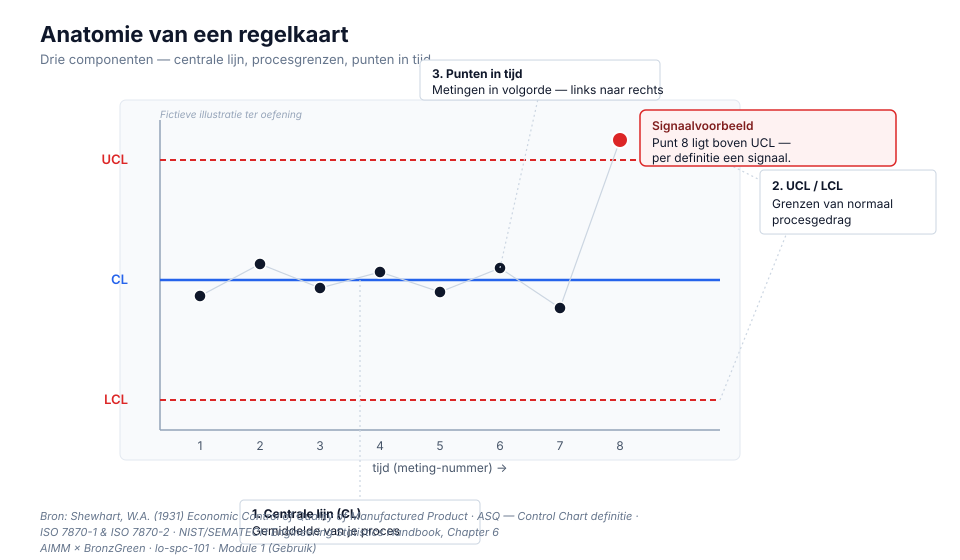

# Wat staat er op die grafiek bij mijn machine?

Op heel veel werkvloeren hangt ergens een grafiek. Op een bord, op het scherm, in het dashboard. Soms kijk je er bewust naar, vaak loop je er langs. Dit leerobject legt uit wat er op zo'n grafiek staat, en waarom die grafiek — een **regelkaart** — jouw tool is.

## Wat leer je?

Je leert de drie basiscomponenten van een regelkaart herkennen:

- Een **centrale lijn** (het gemiddelde gedrag van je proces)
- Een **bovengrens (UCL)** en een **ondergrens (LCL)**
- **Punten in volgorde van tijd**

Daarna kun je in één oogopslag zien of een proces "gewoon doet wat het altijd doet" of dat er iets anders meespeelt.

## Wat SPC is — en wat SPC niet is

SPC staat voor **Statistical Process Control**. Het is **geen inspectie achteraf** — dus niet: "we meten 100 onderdelen na afloop en gooien de slechte weg". SPC is iets anders: je volgt het proces in de tijd op een regelkaart.

Volgens de definitie van ASQ (de American Society for Quality) is een regelkaart een grafiek waarmee je beoordeelt of de variatie in je proces **consistent en voorspelbaar** is, of dat er **onvoorspelbare verstoringen** optreden (bron: ASQ — Control Chart definitie). De internationale norm **ISO 7870-1 en ISO 7870-2** zegt hetzelfde: regelkaarten zijn er om procesgedrag in de tijd te beoordelen (bron: ISO 7870-1, ISO 7870-2).

Met andere woorden: een regelkaart zegt niet of een onderdeel goed of fout is. Hij zegt of je **proces** normaal draait of niet.

## De drie componenten — hoe je een regelkaart leest

Elke regelkaart die je tegenkomt heeft dezelfde opbouw:

**1. De centrale lijn**
Dit is het gemiddelde van je proces. De lijn waar de metingen "omheen horen te liggen" als alles normaal draait.

**2. De bovengrens (UCL) en ondergrens (LCL)**
UCL = Upper Control Limit, LCL = Lower Control Limit. Dit zijn **geen** specificatiegrenzen van de klant. Het zijn de grenzen van het normale procesgedrag. Alles binnen die band is de gewone schommeling van je lijn.

**3. Punten in volgorde van tijd**
De metingen staan **van links naar rechts** in de volgorde waarin je ze hebt gedaan. Punt 1 is de eerste meting, punt 2 de volgende, enzovoort. Daarom is het een **tijdreeks** — geen losse waarden, maar een rij in de tijd.

## Stabiel of onstabiel — zo herken je het

Wanneer lijkt een proces **stabiel** (voorspelbaar)?

- De punten schommelen willekeurig rond de centrale lijn
- Er zit geen duidelijke trend in (niet structureel stijgend of dalend)
- Geen enkel punt komt buiten UCL of LCL
- Geen lange reeksen aan één kant van de lijn

Wanneer lijkt een proces **onstabiel** (onvoorspelbaar)?

- Een of meer punten komen buiten UCL of LCL
- Er is een duidelijke trend (meerdere metingen op rij omhoog of omlaag)
- Een cluster: zeven of meer metingen op rij aan één kant van de centrale lijn
- Of: een onwaarschijnlijk patroon dat je niet had verwacht

Walter Shewhart formuleerde dit principe al in 1931 in zijn boek *Economic Control of Quality of Manufactured Product* — en het staat nog altijd aan de basis van SPC (bron: Shewhart 1931).

## De kernboodschap

> SPC gaat **niet** eerst over productspecificaties halen.
> SPC gaat **eerst** over procesgedrag begrijpen.

Pas als je weet hoe je proces zich normaal gedraagt, kun je zinnig besluiten of een afwijking een echt signaal is of gewoon ruis. Een losse meting zegt weinig. Een **patroon** in meerdere metingen zegt veel.

## Een concreet voorbeeld

Bij een spuitgietlijn meet de operator elke 2 uur 5 onderdeelgewichten. Die gemiddelden komen op de regelkaart. Zolang ze schommelen tussen 99,8 en 100,2 g (binnen UCL/LCL), is er geen reden om in te grijpen. Wanneer drie gemiddelden achter elkaar boven 100,3 g uitkomen, is dat een signaal dat er iets in het proces is veranderd (bron: illustratief voorbeeld, gebaseerd op ko-spc-101).

Dit is geen truc. Het is het verschil tussen kijken naar **één meting** (weinig informatie) en kijken naar een **reeks in de tijd** (veel informatie).

## Na deze sessie

Je kunt:

- De drie componenten van een regelkaart benoemen: centrale lijn, UCL/LCL, punten in tijd
- Op een regelkaart-fragment aangeven of het proces stabiel of onstabiel lijkt
- Uitleggen waarom SPC geen eindcontrole is, maar procesgedrag in de tijd volgt

In de workshop oefen je dit met drie korte regelkaart-fragmenten (wb-01). Daarna reflecteer je op kaarten die je al op je eigen werkvloer hebt gezien (wb-02), en krijg je een handout mee om later nog eens na te lezen (wb-03).

## Transferopdracht: kijk deze week

Loop deze week één keer bewust langs een grafiek, regelkaart of dashboard dat bij of in de buurt van jouw machine hangt. Noteer:

- Welke meting staat erop? (gewicht, diameter, vulhoogte, temperatuur, iets anders?)
- Is er een centrale lijn?
- Zijn er boven- en ondergrenzen zichtbaar (UCL/LCL)?
- In welke richting loopt de tijd? (meestal: links-naar-rechts)

Neem je notities mee naar de volgende sessie. Daar bouwen we op door: wat betekenen de variaties die je ziet, en wanneer moet je wél ingrijpen?

---

*Bron: Shewhart, W.A. (1931) Economic Control of Quality of Manufactured Product; ASQ — Control Chart; ISO 7870-1 & ISO 7870-2; NIST/SEMATECH Engineering Statistics Handbook | AIMM Module 1 — SPC Gebruik | v1.0*

---

## Werkbladen (Kolb-cyclus)

1. [`wb-01-regelkaart-lezen.md`](./werkbladen/wb-01-regelkaart-lezen.md) — Regelkaart lezen
2. [`wb-02-reflectie.md`](./werkbladen/wb-02-reflectie.md) — Reflectie
3. [`wb-03-handout-spc-basics.md`](./werkbladen/wb-03-handout-spc-basics.md) — Handout spc basics

## Verder

- Onderliggend kennisobject: [`ko-spc-101`](../../kennisbank/spc/fundament/ko-spc-101.md)
- Voor de begeleider: [`trainer.md`](./trainer.md) + [`draaiboek.md`](./draaiboek.md)
