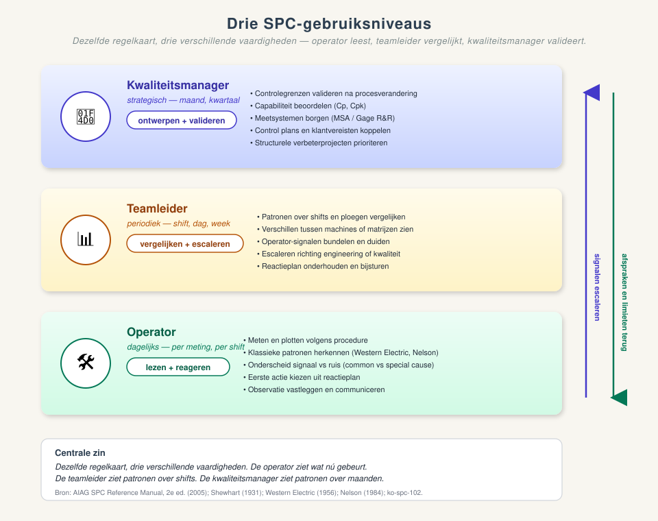

# Regelkaart lezen als operator — welk patroon is een signaal?

Op bijna elke productielijn hangt een regelkaart — op papier of digitaal. Jij bent degene die de punten plot, de patronen ziet en als eerste reageert. Maar niet elk raar ogend punt is een signaal, en niet elk signaal staat buiten de grenzen. Deze sessie leer je de klassieke gedragsregels herkennen en koppelen aan een reactieplan.

## Wat leer je?

Je leert:

- Welke **patronen** op een regelkaart als signaal gelden (klassiek beschreven door Shewhart 1931, Western Electric 1956, Nelson 1984, en samengebracht in de AIAG SPC Reference Manual).
- Het verschil tussen **controlegrenzen** (UCL / LCL — uit het proces) en **tolerantiegrenzen** (USL / LSL — van de klant).
- Hoe je per patroon de **eerste actie** kiest uit een reactieplan: doorgaan, signaal vastleggen, bijsturen, of stoppen en melden.

## De centrale zin

> **Een regelkaart herkent signalen door patronen — niet alleen door grenzen.**
> Een run, trend of zone-patroon binnen de grenzen is óók een signaal.

## Jouw operator-rol (uit ko-spc-102)

SPC werkt op drie niveaus. Dit werkblad gaat over jouw niveau.

| Rol | Wat doe je? |
|-----|-------------|
| **Operator (jij)** | Dagelijks meten, plotten, patroon herkennen, reageren volgens reactieplan |
| Teamleider | Periodiek patronen over shifts, machines, ploegen vergelijken |
| Kwaliteitsmanager | Strategisch limieten valideren, capability beoordelen, control plans beheren |

*Bron: AIAG SPC Reference Manual (2005); ko-spc-102.*

Jouw vaardigheid is: **lezen + reageren** — in het hier-en-nu, op jouw machine, in jouw shift.

## De vier klassieke gedragsregels (korte versie)

Western Electric publiceerde in 1956 de eerste set zone-regels. Lloyd Nelson verfijnde ze in *Journal of Quality Technology* (1984). Operators gebruiken op de werkvloer vooral deze vier.

| # | Regel | Wat zie je op de kaart? | Wat betekent het? |
|---|-------|--------------------------|--------------------|
| 1 | **Punt buiten controlegrens** | Eén punt boven UCL of onder LCL | Special cause — kans ≈ 0,27%, dus vrijwel zeker geen toeval |
| 2 | **Run** | 7 of meer punten op rij aan één kant van de middenlijn | Het procesgemiddelde is aan het schuiven |
| 3 | **Trend** | 6 of meer punten op rij steeds hoger (of steeds lager) | Geleidelijke verschuiving — bijv. slijtage, temperatuur, slijtend gereedschap |
| 4 | **2-uit-3 in waarschuwingszone** | 2 van 3 opeenvolgende punten in zone A (tussen 2σ en 3σ, aan dezelfde kant) | Het proces is instabiel aan die kant |

*Bronnen: Shewhart (1931); Western Electric Statistical Quality Control Handbook (1956); Nelson, L. (1984), "The Shewhart Control Chart — Tests for Special Causes", Journal of Quality Technology 16(4); AIAG SPC Reference Manual, 2nd ed. (2005).*

In de handout (wb-03) staat de volledige Nelson-set van 8 regels. Voor jouw operator-rol is het startpakket deze vier.

## Controlegrens is NIET tolerantiegrens

Een veelgemaakte fout:

| Grens | Waar komt die vandaan? | Wat betekent ze? |
|-------|--------------------------|--------------------|
| **UCL / LCL** (controlegrens) | Uit het **proces zelf** — berekend op basis van gemeten variatie | "Gedraagt mijn machine zich zoals ze hoort?" |
| **USL / LSL** (tolerantiegrens) | Van de **klant** — uit de tekening of specificatie | "Is dit onderdeel bruikbaar voor de klant?" |

Een proces kan binnen de tolerantie draaien (onderdelen zijn "goed") en tóch een signaal geven op de regelkaart. Dat signaal waarschuwt je dat morgen de tolerantiegrens wél gehaald kan worden — als je niks doet. *Bron: AIAG SPC 2005; Montgomery, D.C., Introduction to Statistical Quality Control, 7e editie.*

## Het reactieplan — vier actieniveaus

Als je een patroon herkent, kies je een actie. In de handout staat welke actie bij welk patroon past.

| Niveau | Actie | Wanneer? |
|--------|-------|----------|
| 1 | **Doorgaan** + normaal loggen | Géén patroon — gewone variatie |
| 2 | **Signaal vastleggen** (tijdstip, waarde, wat gezien) | Een run of trend in de rustige zone — nog niet buiten grens |
| 3 | **Bijsturen** volgens procedure + vastleggen | Een duidelijk signaal dat op te lossen is (bijv. centrering) |
| 4 | **Stoppen of melden** aan teamleider / engineering | Punt buiten controlegrens, Cpk-signaal, of twijfel over meetsysteem |

> Het reactieplan per lijn verschilt per bedrijf. Vraag aan je teamleider welk reactieplan voor jouw machine geldt. Is er geen geschreven plan? Dan is jouw observatie zelf al waardevolle input.

## Een concreet voorbeeld (fictief, ter illustratie)

> **Fictieve casus — verpakkingslijn vulgewicht.**
> Tolerantie: 498–502 g. UCL = 501,2; LCL = 498,8; middenlijn = 500,0 g.
> Tijdens jouw shift plot je 9 opeenvolgende punten, allemaal tussen 500,3 en 500,9 g. Geen enkel punt buiten de grenzen. Geen enkel punt buiten tolerantie.
> → Regel 2 (run): 7+ punten aan één kant van de middenlijn.
> → Reactieplan niveau 2 of 3: signaal vastleggen + bijsturen (bijv. dosering verlagen) vóórdat een punt wél UCL raakt.

*Cijfers zijn fictief en dienen als illustratie; geen claim over een echt bedrijf.*

## Wanneer is een signaal GÉÉN signaal?

Niet elk raar ogend punt betekent special cause. Pas op voor:

1. **Nabij de middenlijn schommelen** — dat is precies wat een stabiel proces doet.
2. **Eén uitschieter tussen gewone punten** — kan meetfout zijn; opnieuw meten voordat je bijstuurt.
3. **Ritmisch golfje** — kan een bekende temperatuurcyclus zijn (dag/nacht, opwarming machine). *Bron: Montgomery 7e ed., hoofdstuk over patroonherkenning.*

De kunst is: signaal niet missen én ruis niet als signaal lezen. Allebei fout kost geld.

## Na deze sessie

Je kunt:

- Vier klassieke patronen herkennen: punt-buiten-grens, trend, run, 2-uit-3 in waarschuwingszone.
- Het verschil benoemen tussen controlegrens en tolerantiegrens.
- Per patroon een passende actie kiezen uit het reactieplan.
- Voor je eigen lijn opvragen (of noteren dat er nog geen is) wat het reactieplan is.

In de workshop krijg je een oefening met 4 mini-casussen. Je probeert eerst zelf — daarna duiden we samen.

---

*Bronnen: Shewhart, W.A. (1931), Economic Control of Quality of Manufactured Product; Western Electric Co. (1956), Statistical Quality Control Handbook; Nelson, L.S. (1984), "The Shewhart Control Chart — Tests for Special Causes", JQT 16(4); AIAG (2005), Statistical Process Control Reference Manual, 2nd ed.; Montgomery, D.C. (2012), Introduction to Statistical Quality Control, 7th ed. | ko-spc-102 | AIMM Module 2 — SPC Train | v1.0*

---

## Werkbladen (Kolb-cyclus)

1. [`wb-01-oefening.md`](./werkbladen/wb-01-oefening.md) — Oefening
2. [`wb-02-reflectie.md`](./werkbladen/wb-02-reflectie.md) — Reflectie
3. [`wb-03-handout.md`](./werkbladen/wb-03-handout.md) — Handout

## Verder

- Onderliggend kennisobject: [`ko-spc-102`](../../kennisbank/spc/fundament/ko-spc-102.md)
- Voor de begeleider: [`trainer.md`](./trainer.md) + [`draaiboek.md`](./draaiboek.md)
