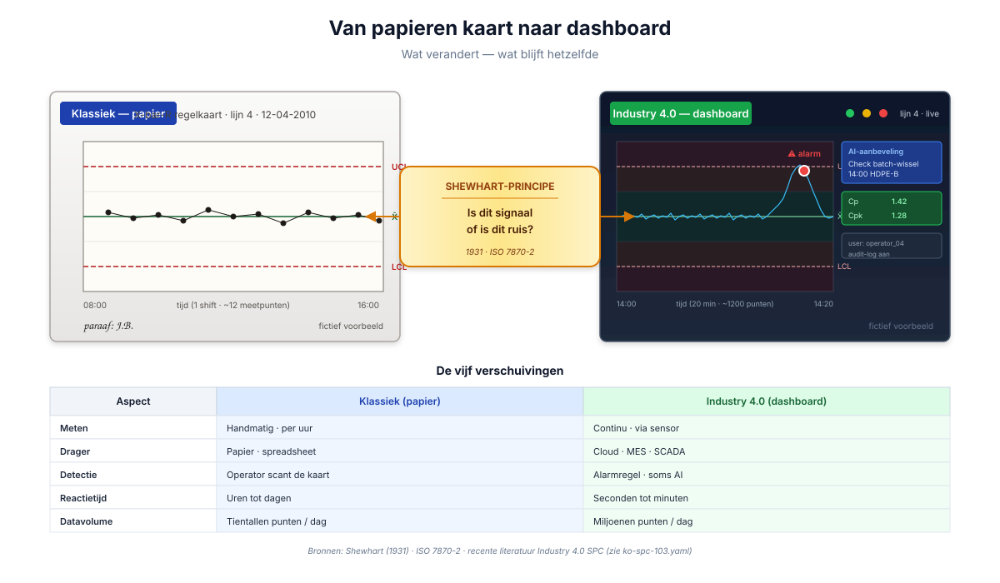

# Van papieren kaart naar dashboard — wat verandert er echt?

Vroeger hing er op de lijn een klembord met een regelkaart. Nu kijk je op een scherm waar de getallen in realtime binnenkomen. Lijkt wereld van verschil. Onder de motorkap gebeurt echter precies hetzelfde: de vraag is nog steeds "is dit normaal of niet?".

## Wat leer je?

Je leert wat er wel en niet verandert wanneer SPC digitaal wordt. Je leert waarom het Shewhart-principe — signaal of ruis? — ook bij dashboards gewoon doorgaat. En je leert wat dat betekent voor wat jij als operator moet kunnen.

## Even terugblikken: wat is SPC?

SPC staat voor *Statistical Process Control*. Dat is een manier om je proces in de tijd te volgen en te kijken of de variatie normaal is (common cause) of dat er iets ánders aan de hand is (special cause). Zie ko-spc-101 voor de basis.

## De regelkaart — hoe het was

Ooit bedacht door Walter Shewhart in 1931 (bron: Shewhart, W.A. (1931) *Economic Control of Quality of Manufactured Product*, vandaag nog de basis van ISO 7870-2 voor Shewhart-regelkaarten). Een operator nam elk uur een steekproef, mat vijf onderdelen, berekende het gemiddelde en de spreiding, en zette twee punten op een papieren kaart. Tien punten per dag, misschien dertig. Een trend zag je pas na uren.

Wat dat jou als operator vroeg:
- Zelf meten en plotten
- Zelf de kaart scannen
- Zelf herkennen wanneer een punt "eruit" lag
- Zelf actie nemen of melden

## Het dashboard — hoe het nu is

Sensoren meten continu. Soms meerdere keren per seconde. Een MES- of SCADA-systeem (bron: zie KO-bronnenlijst — recente literatuur Industry 4.0 SPC) verzamelt die data, berekent gemiddelden en ranges automatisch, en toont regelkaarten op een scherm. Als een regel wordt overtreden, gaat er een alarm af. Soms binnen 30 seconden.

Wat dat jou als operator vraagt:
- Het scherm kunnen lezen
- Herkennen wat een alarm *betekent* (niet alleen wegklikken)
- Weten welke regels eronder zitten
- Begrijpen wanneer een alarm een echt signaal is en wanneer het niet zoveel zegt

## Wat verandert — de vijf verschillen

| Aspect | Klassiek (papier) | Industry 4.0 (dashboard) |
|--------|-------------------|---------------------------|
| Meten | Handmatig, periodiek | Continu via sensoren |
| Drager | Papier of spreadsheet | Cloud/MES/SCADA-scherm |
| Detectie | Jij scant de kaart | Automatische alarmregels + soms AI |
| Reactietijd | Uren tot dagen | Seconden tot minuten |
| Datavolume | Tientallen punten per dag | Miljoenen punten per dag |

## Wat blijft exact hetzelfde

Het **Shewhart-principe**: onderscheid maken tussen normale variatie en een echt signaal. Een sensor die elke seconde meet verandert niets aan de vraag "is dit signaal of ruis?". Die vraag blijft het hart van SPC.

Een dashboard dat binnen 30 seconden piept is niet automatisch slimmer dan een papieren kaart. Het signaleert alleen sneller. Of het piept omdat er écht iets aan de hand is, of omdat de regel te streng staat — dat is dezelfde afweging als vroeger.

## Wat betekent dat voor jouw rol?

Jouw werk verschuift van *kaart tekenen* naar *procesgedrag begrijpen, ongeacht het scherm*. Dat klinkt abstract, dus concreet:

- Je plot geen punten meer — het dashboard doet dat.
- Je moet wel snappen wát het dashboard plot. Is het een X-bar-R-kaart? Een trendgrafiek? Een ruwe sensormeting?
- Je reageert niet meer uren later op een trend — je reageert mogelijk binnen minuten. Dat vraagt helderheid over wat het alarm betekent voordat je iets doet.
- Als een AI-module een aanbeveling geeft ("reset nozzle 3"), moet je kunnen inschatten of dat advies klopt voor jouw situatie.

De valkuil: alarmen wegklikken zonder erover na te denken. Dan ben je operator van het scherm in plaats van operator van het proces.

## Een voorbeeld uit de praktijk

*Fictieve casus, ter illustratie.* Een verpakkingslijn woog vroeger elke 2 uur 5 verpakkingen met de hand. De operator noteerde het gemiddelde op een kaart, 4–5 punten per shift. Nu meet een inline-weegcel elke verpakking. Duizenden punten per uur gaan naar een MES-dashboard. Een regel berekent X-bar-R per minuut. Stijgt de range plotseling, dan verschijnt binnen 30 seconden een alarm.

De operator hoeft niet meer te plotten. Wel moet hij snappen wat *range stijgt* betekent: de spreiding wordt groter, er zit meer variatie in de verpakkingen dan eerder. Dat vraagt om onderzoek — een losgelopen doseerschroef, een probleem met de weegcel zelf, een bak gewijzigd materiaal. Hetzelfde denken als vroeger, alleen sneller en met andere gereedschappen.

## Na deze sessie

Je kunt:
- Uitleggen wat er verandert en wat hetzelfde blijft als SPC digitaal wordt
- Benoemen wat de vijf belangrijkste verschuivingen zijn (meten, drager, detectie, reactietijd, datavolume)
- Het Shewhart-principe herkennen als "de vraag die onder elk dashboard zit"
- Inschatten welke vaardigheden dat van jou als operator vraagt

In de volgende module (Train) ga je zelf met een dashboard werken — regels instellen, alarmen interpreteren, aanbevelingen wegen.

---

*Bronnen inline: Shewhart (1931) + ISO 7870-2 voor het klassieke principe; recente literatuur Industry 4.0 SPC voor de vijf verschuivingen. Zie ko-spc-103.yaml (`metadata.source_ref`) voor de volledige bronvermelding van het onderliggende kennisobject.*

---

## Werkbladen (Kolb-cyclus)

1. [`wb-01-vergelijk-papieren-en-digitaal.md`](./werkbladen/wb-01-vergelijk-papieren-en-digitaal.md) — Vergelijk papieren en digitaal
2. [`wb-02-reflectie.md`](./werkbladen/wb-02-reflectie.md) — Reflectie
3. [`wb-03-handout-klassiek-vs-industry40.md`](./werkbladen/wb-03-handout-klassiek-vs-industry40.md) — Handout klassiek vs industry40

## Verder

- Onderliggend kennisobject: [`ko-spc-103`](../../kennisbank/spc/ai_integratie/ko-spc-103.md)
- Voor de begeleider: [`trainer.md`](./trainer.md) + [`draaiboek.md`](./draaiboek.md)
