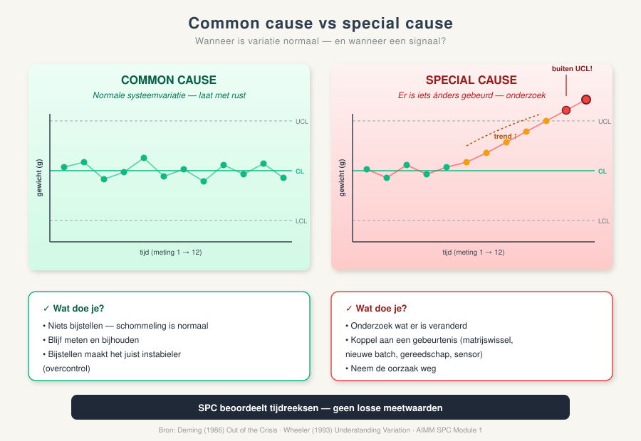

# Wanneer wel en wanneer niet aan een knop draaien?

Op je lijn schommelen getallen. Soms moet je ingrijpen. Vaker moet je niets doen. Het verschil zien tussen die twee — dat is het hart van SPC.

## Wat leer je?

Je leert het verschil herkennen tussen **gewone variatie** (de lijn doet wat hij altijd doet) en **iets ánders dan normaal** (er is een echte verstoring). En je leert waarom "snel iets corrigeren" je proces vaak juist slechter maakt.

## Twee soorten variatie

Elke productielijn schommelt. De vraag is: hoort die schommeling bij het normale gedrag, of is er iets aan de hand?

### Gewone variatie (common cause)

Dit is het normale patroon van je lijn. Komt van:
- Kleine temperatuurschommelingen door de dag
- Minieme verschillen in materiaalvocht of -batch
- Normale slijtage van gereedschap
- Gewone meetruis

Je herkent het aan: willekeurige spreiding rond het gemiddelde, geen onwaarschijnlijke patronen, geen extreme uitschieters.

### Echte verstoring (special cause)

Hier is iets ánders gebeurd dan normaal. Bijvoorbeeld:
- Verkeerde materiaalbatch geladen
- Vastlopend thermokoppel
- Verstopte nozzle
- Verkeerd gereedschap gemonteerd

Je herkent het aan: een sprong, een trend, een lange reeks aan één kant van het gemiddelde, of een punt buiten de regelgrenzen.

## Waarom je geen losse meting beoordeelt

Eén onderdeel op 100,02 g zegt weinig. Tien opeenvolgende metingen die langzaam omhoog kruipen op een spuitgietlijn zegt veel meer. SPC kijkt naar tijdreeksen, niet naar losse waarden.

## De valkuil: tampering

Als je op elke afwijking reageert alsof het een echte verstoring is, ga je tamperen. Een operator die na elke meting "even bijstuurt" duwt het proces heen-en-weer en vergroot de spreiding.

Deming heeft dit met zijn beroemde funnel-experiment laten zien. Vier strategieën:
1. Niets doen → laagste spreiding (winnaar)
2. Compenseren naar het doel → spreiding verdubbelt
3. Compenseren naar het laatste punt → exponentieel afdrijven
4. Compenseren naar de laatste meting → random walk

Strategie 1 wint altijd zolang het proces stabiel is. "Niet elke afwijking corrigeren" is geen luiheid — het is statistische discipline.

## Wanneer wel ingrijpen?

Pas reageren bij een **echt signaal**:
- Een punt buiten de regelgrenzen
- Een trend van meerdere metingen
- Een patroon dat statistisch onwaarschijnlijk is

In de werkplaats zie je dat als één meting buiten UCL of LCL, of een duidelijke shift na een proceswijziging.

## Een concreet voorbeeld

Op een spuitgietlijn beweegt het onderdeelgewicht door de dag tussen 99,8 en 100,2 g — door buitentemperatuur en koelwater. **Common cause** — laat dat met rust.

Maar als het gewicht plotseling drie metingen achtereen op 100,5 g uitkomt na een matrijswissel, dan is dat **special cause**. Onderzoek de matrijsinstelling.

## Na deze sessie

Je kunt:
- Het verschil benoemen tussen common cause en special cause
- Uitleggen waarom tampering het proces slechter maakt
- Bij een out-of-control signaal niet meteen aan de knoppen draaien, maar eerst onderzoeken

In de workshop oefen je dit met een storingsquiz: kort gezegd 10 mini-casussen waarin je inschat wat er aan de hand is.

---

## Werkbladen (Kolb-cyclus)

1. [`wb-01-storingsquiz.md`](./werkbladen/wb-01-storingsquiz.md) — Storingsquiz
2. [`wb-02-reflectie.md`](./werkbladen/wb-02-reflectie.md) — Reflectie
3. [`wb-03-handout-theorie.md`](./werkbladen/wb-03-handout-theorie.md) — Handout theorie
4. [`wb-04-actieplan.md`](./werkbladen/wb-04-actieplan.md) — Actieplan

## Verder

- Onderliggend kennisobject: [`ko-spc-104`](../../kennisbank/spc/variatie_analyse/ko-spc-104.md)
- Voor de begeleider: [`trainer.md`](./trainer.md) + [`draaiboek.md`](./draaiboek.md)
