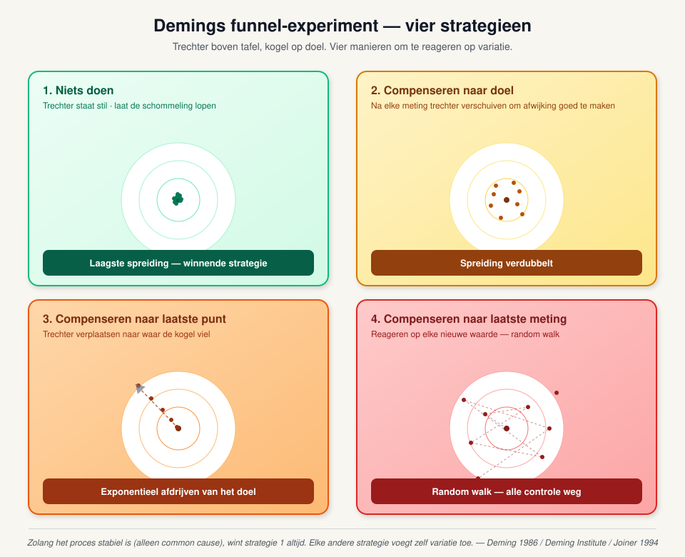

# Niet elke afwijking is een reden om te draaien

Soms is de beste actie: geen actie. Deze les gaat over de valkuil die bijna elke operator een keer maakt — en hoe je er niet meer intrapt.

## Wat leer je?

Je leert wat **tampering** is: ingrijpen op een meetwaarde die gewoon bij de normale variatie van je lijn hoort. En je leert waarom stilhouden — en escaleren als het moet — vaak beter werkt dan aan een knop draaien.

## Wat is tampering?

Tampering betekent: reageren op normale schommeling alsof er iets aan de hand is. Een operator die na elke meting "even bijstuurt", duwt het proces heen-en-weer. Het resultaat? De spreiding wordt groter in plaats van kleiner.

Je corrigeert een schommeling die niet gecorrigeerd hoefde te worden — en je voegt zelf nieuwe variatie toe.

## Het funnel-experiment van Deming

W. Edwards Deming heeft dit beroemd gemaakt met zijn **funnel-experiment**. Het idee is simpel: hij zette een trechter boven een tafel, liet er een kogel doorheen vallen, en probeerde die op een doel te krijgen. Na elke worp werden er vier strategieën uitgeprobeerd:

1. **Niets doen** — trechter staat stil → laagste spreiding
2. **Compenseren naar het doel** — trechter verschuiven om de laatste afwijking goed te maken → spreiding verdubbelt
3. **Compenseren naar het laatste punt** — trechter verplaatsen naar waar de kogel viel → afdrijven, de bal komt steeds verder weg
4. **Compenseren naar de laatste meting** — reageren op elke nieuwe waarde → random walk, totaal geen controle meer

**Strategie 1 — niets doen — wint altijd**, zolang het proces stabiel is (alleen common cause). Het Deming Institute beschrijft dit experiment als de klassieke illustratie van wat er gebeurt als je aanpassingen doet zonder eerst de oorzaak te begrijpen.

Joiner vatte het kernachtig samen: **overreageren verhoogt variatie én kosten**.

## De regel voor jou als operator

"Niet elke afwijking corrigeren" is geen luiheid. Het is statistische discipline. Wacht op een **signaal** voordat je ingrijpt.

### WEL ingrijpen bij:

- Een punt buiten de regelgrenzen (UCL / LCL)
- Een Nelson-patroon of duidelijke trend over meerdere metingen
- Een sprong of cluster na een proceswijziging (matrijs, batch, gereedschap)

### NIET ingrijpen bij:

- Eén losse meting die toevallig hoger of lager is
- Variatie binnen de normale bandbreedte
- Onderbuikgevoel zonder data

## En als je toch zorgen hebt?

Soms is de common cause variatie gewoon te groot. De schommelingen zijn binnen specs, maar je klanten klagen. Dan is er iets mis met het **systeem**, niet met een losse meting.

Wat dan? **Escaleren, niet zelf draaien.** Meld het bij je teamleider of bij engineering. Zij kunnen een procesverbetering inzetten (betere matrijs, nieuwe sensor, andere materiaalspecificatie). Dat is geen operator-werk — dat is systeemwerk.

## Een voorbeeld: de vulgewicht-val

*Fictieve illustratie:*

Een operator op een verpakkingslijn ziet het vulgewicht op 502 gram staan. Specs zijn 500 ± 5 gram — dus ruim binnen marge. Maar hij draait de pomp 0,2 gram terug. Volgende meting: 498 gram. Hij draait 0,4 gram op. Volgende: 503 gram. Volgende: 497 gram.

Na een uur is de spreiding verdubbeld. Niet door de machine — door zijn eigen "correcties". Klassieke tampering.

Wat had hij moeten doen? **Niets.** De waardes zaten ruim binnen specs en binnen het normale patroon.

## Na deze sessie

Je kunt:
- Uitleggen wat tampering is en waarom het variatie vergroot
- Bij een afwijking binnen de normale bandbreedte **niet** aan de knoppen draaien
- Herkennen wanneer een signaal echt is (punt buiten grenzen, trend, cluster)
- Escaleren naar teamleider of engineering als de common cause variatie zelf te groot is

In de workshop oefen je dit met een meetcasus en kijk je terug op een moment uit je eigen werk waarin je hebt gecorrigeerd — en het niet beter werd.

---

*Bronnen: Deming, W.E. (1986) *Out of the Crisis*, MIT Press. Het funnel-experiment wordt beschreven door het Deming Institute (deming.org) als klassieke illustratie van de gevolgen van aanpassen zonder oorzaakbegrip. Joiner, B.L. (1994) *Fourth Generation Management*, McGraw-Hill — "overreageren verhoogt variatie én kosten".*

---

## Werkbladen (Kolb-cyclus)

1. [`wb-01-meetcasus-vulgewicht.md`](./werkbladen/wb-01-meetcasus-vulgewicht.md) — Meetcasus vulgewicht
2. [`wb-02-reflectie.md`](./werkbladen/wb-02-reflectie.md) — Reflectie
3. [`wb-03-handout-signalen-vs-ruis.md`](./werkbladen/wb-03-handout-signalen-vs-ruis.md) — Handout signalen vs ruis

## Verder

- Onderliggend kennisobject: [`ko-spc-105`](../../kennisbank/spc/variatie_analyse/ko-spc-105.md)
- Voor de begeleider: [`trainer.md`](./trainer.md) + [`draaiboek.md`](./draaiboek.md)
