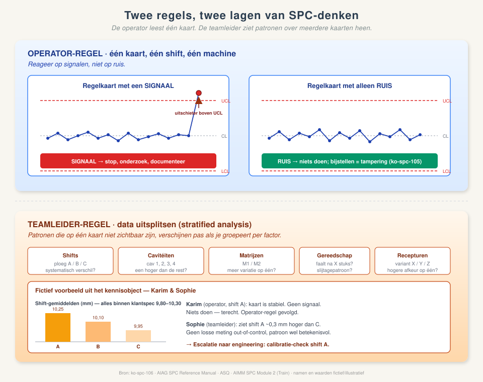

# Wanneer reageer je op de regelkaart — en wanneer niet?

Op je lijn staat een SPC-regelkaart. Soms schiet een punt dicht tegen de grens aan. Soms zie je drie metingen op rij die allemaal aan dezelfde kant van het midden zitten. De vraag is elke keer dezelfde: is dit een **signaal** waarop ik moet reageren, of is dit **ruis** waarbij ik juist niets moet doen?

## Wat leer je?

- Je leert het verschil herkennen tussen een **signaal** (reageren) en **ruis** (niet reageren) op je eigen regelkaart.
- Je leert dat ingrijpen bij ruis het probleem groter maakt — dat heet **tampering** (uit ko-spc-105).
- Je krijgt een eerste kijk op de **teamleider-regel**: wat je teamleider ziet als hij/zij data uitsplitst naar shift, caviteit of matrijs.

## De twee regels

### De operator-regel (voor jou, vandaag)

> **Reageer op signalen, niet op ruis.**

- Een **signaal** is een data-patroon dat **statistisch onwaarschijnlijk** is bij normale variatie. Bijvoorbeeld: een punt buiten de controlegrens, of 7 metingen op rij aan dezelfde kant van het midden.
- **Ruis** is normale schommeling binnen de bandbreedte. Een proces is nooit perfect stabiel — kleine schommelingen horen erbij.

**Bij een signaal:** **stop → onderzoek → documenteer.**
**Bij ruis:** **niets doen.** Aan de knop draaien maakt het alleen maar erger.

### De teamleider-regel (voorproefje voor Module 3)

Jouw regelkaart laat zien wat er op **jouw** shift, op **jouw** machine gebeurt. Maar sommige patronen zie je alleen als je verder kijkt dan één kaart:

| Patroontype | Wat zie je? |
|-------------|-------------|
| Verschil tussen **shifts** | Ploeg A en C stabiel, ploeg B niet |
| Verschil tussen **caviteiten** | Caviteit 4 systematisch hoger dan 1-3 |
| Verschil tussen **matrijzen** | Matrijs M2 geeft consistent meer variatie |
| Verschil tussen **gereedschappen** | Specifieke tool faalt na X stuks |
| Verschil tussen **recepturen** | Variant Z heeft hogere afkeur |

Dit is het werk van de teamleider — data uitsplitsen naar deze factoren. Voor jou als operator is het vooral **bewustwording**: je eigen kaart vertelt niet het hele verhaal.

## Een concreet voorbeeld (uit het kennisobject) — *fictief, illustratief*

> Operator **Karim** op shift A kijkt naar zijn regelkaart. Alle punten vallen netjes binnen de grenzen. Geen signaal. Hij produceert door — terecht.
>
> Maar teamleider **Sophie** bekijkt aan het eind van de week de data van alle drie de shifts naast elkaar. Ze ziet dat shift A **systematisch 0,3 mm hoger** meet dan shift C. Geen enkele losse meting uit shift A is out-of-control. Maar het verschil **tussen** shifts is een patroon dat alleen zichtbaar wordt als je de data uitsplitst.
>
> Sophie escaleert naar engineering voor een calibratie-check: misschien meet shift A met een andere meter of een andere methode.

Dit is precies het verschil:
- **Karim** volgt de operator-regel correct: geen signaal op zijn kaart → niet reageren.
- **Sophie** volgt de teamleider-regel: uitsplitsen → patroon zichtbaar → actie.

*Bron: ko-spc-106 (AIAG SPC Reference Manual; ASQ). Namen en exacte waarden zijn illustratief.*

## Waarom tampering bij ruis gevaarlijk is

Als je aan de knoppen gaat draaien bij een normale schommeling (ruis), dan:

1. De volgende schommeling komt — want ruis blijft bestaan.
2. Jouw bijstelling werkt nu **boven** op die schommeling.
3. Gevolg: de spreiding wordt **groter**, niet kleiner.

Dit heet tampering (zie ko-spc-105). Het is één van de vaakst gemaakte fouten op de vloer. Niet uit onkunde — uit de verleiding om "iets te doen".

## Waar dit vandaag heen gaat

1. **Sprint** — je krijgt 6 snapshots van regelkaarten en één tabel met metingen uitgesplitst naar shift. Je beoordeelt elke situatie: signaal of ruis? En bij de tabel: zie je iets wat een individuele operator op zijn eigen kaart niet ziet?
2. **Reflectie** — we bespreken de sprint plenair. Daarna denk je thuis terug op één eigen moment waarop je twijfelde tussen ingrijpen en niets doen.
3. **Handout** — we lopen de regels en het Karim & Sophie-voorbeeld door.

## Na deze sessie kun je

- Het verschil benoemen tussen een signaal (reageren) en ruis (niet reageren) op je eigen regelkaart.
- Uitleggen waarom ingrijpen bij ruis de variatie groter maakt (tampering).
- Herkennen dat je teamleider via uitsplitsing naar shift of machine patronen ziet die jij op je eigen kaart niet kunt zien.
- Deze week op je eigen lijn één kaart drie shifts lang bewust volgen en je keuzes documenteren.

---

*Bron: ko-spc-106 (AIAG SPC Reference Manual; ASQ) — operator-regel en teamleider-regel voor signaal/ruis onderscheid. Zie ook ko-spc-104 (stabiel proces) en ko-spc-105 (tampering). | AIMM Module 2 — SPC Train | v1.0*

---

## Werkbladen (Kolb-cyclus)

1. [`wb-01-oefening.md`](./werkbladen/wb-01-oefening.md) — Oefening
2. [`wb-02-reflectie.md`](./werkbladen/wb-02-reflectie.md) — Reflectie
3. [`wb-03-handout.md`](./werkbladen/wb-03-handout.md) — Handout

## Verder

- Onderliggend kennisobject: [`ko-spc-106`](../../kennisbank/spc/variatie_analyse/ko-spc-106.md)
- Voor de begeleider: [`trainer.md`](./trainer.md) + [`draaiboek.md`](./draaiboek.md)
