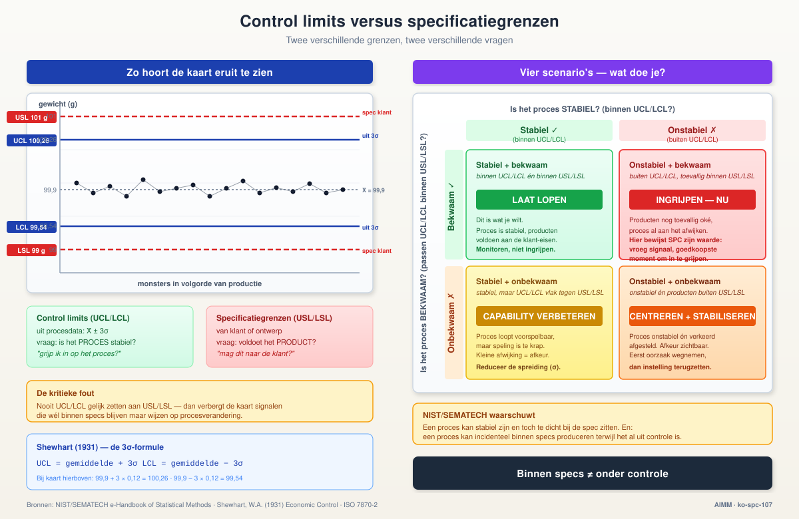

# Zijn die lijnen op je regelkaart de grenzen van de klant, of van het proces?



Op veel werkvloeren hangen regelkaarten aan de wand. Er staan lijnen op: een bovengrens, een ondergrens. Iedereen kijkt ernaar. Maar wie heeft die lijnen getekend — en op basis waarvan? Dat is precies waar het in deze sessie om draait.

## Wat leer je?

Je leert het verschil herkennen tussen **control limits** (UCL/LCL, grenzen van het PROCES) en **specificatiegrenzen** (grenzen van het PRODUCT). En je leert waarom het een kritieke fout is om die twee door elkaar te halen — een fout die veel vaker voorkomt dan je denkt.

## Twee verschillende vragen

Elke regelkaart beantwoordt een vraag. Het probleem is: er zijn twee verschillende vragen, en veel mensen weten niet welke ze aan het beantwoorden zijn.

### Vraag 1: Voldoet dit product aan wat de klant vraagt?
Die grenzen heten **specificatiegrenzen**. Een klant zegt bijvoorbeeld: "het onderdeel moet 100 gram wegen, plus of min 1 gram." Dan zijn de specs 99 tot 101 gram. Die waarden komen van de klant of van het ontwerp. Ze staan los van hoe jouw machine draait.

### Vraag 2: Loopt mijn proces stabiel?
Die grenzen heten **control limits** (UCL = Upper Control Limit, LCL = Lower Control Limit). Die grenzen bereken je uit je eigen procesmetingen. De formule komt van Shewhart (1931), de uitvinder van de regelkaart:

```
UCL = gemiddelde + 3σ
LCL = gemiddelde − 3σ
```

Het gemiddelde en de σ (spreiding) komen uit metingen van je eigen lijn. Niet van de klant.

## Het verschil in een tabel

| | Control limits (UCL/LCL) | Specificatiegrenzen |
|---|--------------------------|---------------------|
| **Welke vraag?** | Loopt het PROCES stabiel? | Voldoet het PRODUCT aan de eisen? |
| **Waar komen ze vandaan?** | Uit eigen procesdata (gemiddelde ± 3σ) | Van de klant of het ontwerp |
| **Waar staan ze op de kaart?** | Op de regelkaart zelf | Apart (of helemaal niet op de kaart) |
| **Welke beslissing?** | "Moet ik ingrijpen in het proces?" | "Mag dit onderdeel naar de klant?" |

## Wat NIST zegt

Het Amerikaanse NIST is een referentie-instituut voor meten en testen. In het *NIST/SEMATECH e-Handbook of Statistical Methods* staat expliciet gewaarschuwd:

> Een proces kan stabiel zijn (binnen control limits) en toch te dicht bij de specificatiegrens zitten.  
> Omgekeerd: een proces kan incidenteel binnen specs produceren terwijl het proces al uit controle is.

Met andere woorden: **binnen specs betekent niet automatisch onder controle**. En **uit controle betekent niet automatisch afkeur**. Het zijn twee verschillende dingen.

## De kritieke fout

De fout die je op werkvloeren vaak ziet: iemand tekent een regelkaart en zet de specs (99-101) als UCL/LCL neer. Klaar. De kaart ziet er goed uit.

Wat is er fout aan?

- Het is geen kaart van je procesgedrag meer. Het is een pass/fail-grafiek geworden.
- Je verbergt verstoringen die nog binnen specs blijven maar wél je proces signaleren.
- Een trend van 99,8 → 99,9 → 100,0 → 100,1 zou nooit een signaal geven — terwijl het wel degelijk wijst op een procesverandering.
- Je mist het moment waarop je vroeg kunt ingrijpen.

**Nooit control limits uit klanttoleranties afleiden.** Dat is de harde regel.

## Hoe dan wel?

Zo bereken je control limits correct:

1. Verzamel een reeks metingen van je eigen proces (minimaal 25-30 opeenvolgende metingen als het proces stabiel loopt).
2. Bereken het gemiddelde.
3. Bereken de standaardafwijking (σ). Dat doet meestal een SPC-programma of Excel voor je.
4. Bereken: UCL = gemiddelde + 3σ en LCL = gemiddelde − 3σ.
5. Teken die twee lijnen op de kaart.
6. De specs? Die zet je op een ander vlak, of helemaal niet op de kaart. Sommige bedrijven doen dat bewust om verwarring te voorkomen.

## Een concreet voorbeeld

Op een spuitgietlijn vraagt de klant onderdeelgewicht 100 ± 1 g (specs: 99-101). De operator verzamelt 100 metingen: gemiddelde 99,9 g, σ = 0,12 g.

Correct:
- UCL = 99,9 + 3 × 0,12 = **100,26 g**
- LCL = 99,9 − 3 × 0,12 = **99,54 g**

De control limits (99,54-100,26) liggen ruim binnen de specs (99-101). Dat betekent: het proces is stabiel én bekwaam. Mooi.

Fout:
- UCL/LCL gelijk zetten aan 99 en 101 (de specs).

Bij de foute aanpak zou een trend van 99,8 → 99,9 → 100,0 → 100,1 nooit een signaal geven — de waarden blijven binnen 99-101. Maar die trend wijst wél op een procesverandering die je met correcte control limits (99,54-100,26) wél had opgepikt.

## Na deze sessie

Je kunt:
- In eigen woorden uitleggen wat het verschil is tussen control limits en specificatiegrenzen.
- Op een regelkaart aanwijzen of er procesgrenzen of productgrenzen zijn ingevuld.
- Herkennen wanneer een kaart fout is opgezet (specs als UCL/LCL).
- Globaal uitleggen hoe control limits wél correct berekend worden (3σ-regel).

En je neemt een vraag mee naar je eigen werkplek: *"Zijn de lijnen op onze regelkaarten procesgrenzen of productgrenzen?"*

---

**Bronnen:**
- NIST/SEMATECH *e-Handbook of Statistical Methods*, sectie over Control Charts versus Specification Limits (https://www.itl.nist.gov/div898/handbook/)
- Shewhart, W.A. (1931) *Economic Control of Quality of Manufactured Product* — oorsprong van de 3σ-regel
- ISO 7870-2 (regelkaartstandaard)

---

## Werkbladen (Kolb-cyclus)

1. [`wb-01-spot-the-fout.md`](./werkbladen/wb-01-spot-the-fout.md) — Spot the fout
2. [`wb-02-reflectie.md`](./werkbladen/wb-02-reflectie.md) — Reflectie
3. [`wb-03-handout-verschil-control-vs-specs.md`](./werkbladen/wb-03-handout-verschil-control-vs-specs.md) — Handout verschil control vs specs

## Verder

- Onderliggend kennisobject: [`ko-spc-107`](../../kennisbank/spc/regelkaarten/ko-spc-107.md)
- Voor de begeleider: [`trainer.md`](./trainer.md) + [`draaiboek.md`](./draaiboek.md)
