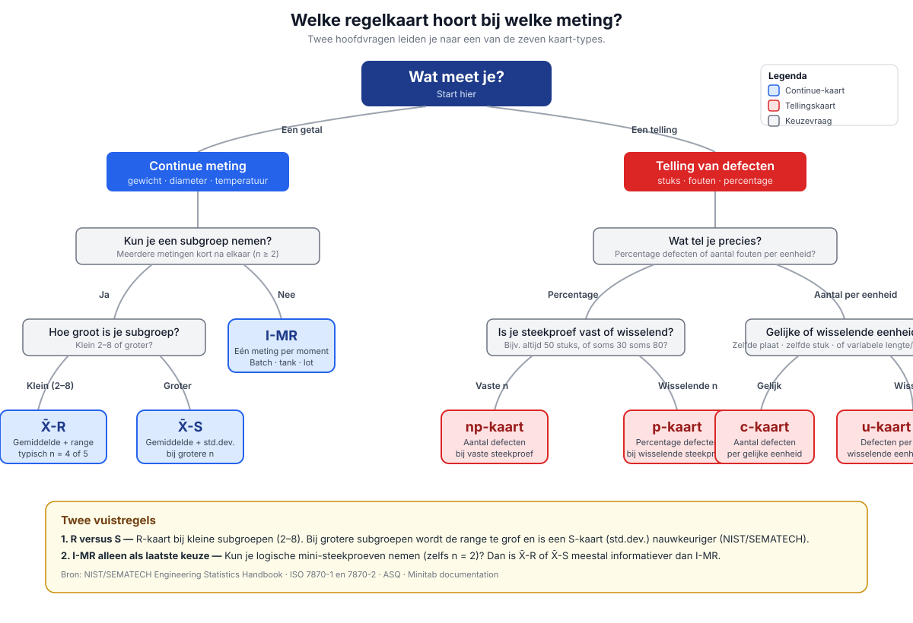

# Welke regelkaart hoort bij welke meting?



Op je werkvloer hangen regelkaarten. Soms één, soms verschillende naast elkaar. Maar waarom kiest engineering juist díe kaart voor jouw lijn? Als je dat snapt, lees je de kaart ook beter af.

## Wat leer je?

Je leert de **zeven standaard regelkaarten** uit de maakindustrie kennen, en welke kaart hoort bij welke soort meting. Je hoeft ze niet zelf te maken — je moet kunnen lezen waarom er voor jouw lijn die ene is gekozen.

## Twee hoofdvragen — meer hoef je eerst niet te weten

Alle zeven kaart-types komen neer op twee eenvoudige vragen:

1. **Wat meet je?** Een getal (continue meting — zoals gewicht, diameter, temperatuur)? Of tel je iets (aantal defecten, percentage foute stuks)?
2. **Is je steekproef elke keer even groot?** Een vaste steekproef van 50? Of varieert het (soms 30, soms 80)?

Die twee vragen leiden je naar het juiste kaart-type.

## De zeven kaart-types op een rij

### Voor continue metingen (gewicht, diameter, temperatuur, viscositeit)

| Kaart | Wanneer | Voorbeeld uit de fabriek |
|-------|---------|--------------------------|
| **X̄-R** | Kleine subgroep (2–8, meestal 4 of 5) | Elke 2 uur 5 onderdelen wegen op spuitgietlijn |
| **X̄-S** | Grotere subgroep of meer precisie nodig | Lasersensor meet elke seconde de dikte (n=30 per minuut) |
| **I-MR** | Eén meting per moment of batch | Viscositeit per batch in voeding of chemie |

### Voor tellingen (defecte stuks, fouten per oppervlak)

| Kaart | Wanneer | Voorbeeld uit de fabriek |
|-------|---------|--------------------------|
| **p-kaart** | Percentage defecte stuks, **wisselende** steekproef | Percentage lekkende verpakkingen per steekproef |
| **np-kaart** | Aantal defecte stuks, **vaste** steekproef | Aantal fout-geassembleerde sets in monsters van 50 |
| **c-kaart** | Aantal defecten per **gelijke** eenheid | Aantal krassen per vast plaatoppervlak |
| **u-kaart** | Defecten per **wisselende** eenheid | Aantal fouten per meter folie |

## De beslis-stroom

```
Wat meet je?

├── Een getal (continue meting)?
│     ├── Kun je een subgroep nemen (meerdere metingen achter elkaar)?
│     │     ├── Kleine subgroep (2 tot 8)? ...... X̄-R
│     │     └── Grotere subgroep? ............... X̄-S
│     └── Nee, maar één meting per moment? ..... I-MR
│
└── Tellingen van defecten?
      ├── Percentage defecten?
      │     ├── Vaste steekproef? ............... np-kaart
      │     └── Wisselende steekproef? .......... p-kaart
      └── Aantal defecten per eenheid?
            ├── Gelijke eenheid? ................ c-kaart
            └── Wisselende eenheid? ............. u-kaart
```

## Twee vuistregels om te onthouden

**1. R versus S — subgroep-grootte beslist.**
Gebruik **R-kaarten bij kleine** subgroepen (2–8). Bij grotere subgroepen wordt de range-berekening te grof en is een **S-kaart** (standaarddeviatie) nauwkeuriger.

**2. I-MR alleen als het écht niet anders kan.**
Als je meerdere metingen kort na elkaar kunt doen — zelfs maar twee — kies dan X̄-R of X̄-S. Die geven meer informatie dan I-MR. Pak I-MR pas als subgroeperen onmogelijk is (bijvoorbeeld bij een meting per batch of per tank).

## Hoe lees je als operator zo'n kaart?

Elk kaart-type heeft een eigen manier van lezen:

- **X̄-R en X̄-S:** boven zie je het gemiddelde (verschuift het?), onder de spreiding (blijft die stabiel?).
- **I-MR:** individuele waarden boven, moving range onder.
- **p en np:** defectpercentage of aantal defecten — zoek naar een oplopende trend.
- **c en u:** defectdichtheid — meer fouten dan normaal?

De beslis-stroom en de leesregel samen vertellen je wat engineering zag toen ze de kaart kozen.

## Na deze sessie kun je

- De 7 kaart-types benoemen en in twee hoofdgroepen indelen (continue en tellingen)
- Per type in één zin vertellen wanneer je hem gebruikt
- Het verschil uitleggen tussen **p en np** (wisselende versus vaste steekproef)
- Het verschil uitleggen tussen **c en u** (gelijke versus wisselende eenheid)
- Voor één meting van je eigen lijn aanwijzen welk kaart-type erbij hoort

## In de workshop

Je krijgt een puzzel met vijf meetcasussen uit de maakindustrie. Je kiest eerst zelf de kaart — op gevoel. Daarna bespreken we samen, en daarna komt pas de theorie. Zo voel je eerst welke vraag je jezelf moet stellen.

---
*Bron: NIST/SEMATECH Engineering Statistics Handbook; ISO 7870-1 en 7870-2; ASQ; Minitab documentation | ko-spc-108 | AIMM Module 2 — SPC Train | v1.0*

---

## Werkbladen (Kolb-cyclus)

1. [`wb-01-oefening.md`](./werkbladen/wb-01-oefening.md) — Oefening
2. [`wb-02-reflectie.md`](./werkbladen/wb-02-reflectie.md) — Reflectie
3. [`wb-03-handout.md`](./werkbladen/wb-03-handout.md) — Handout

## Verder

- Onderliggend kennisobject: [`ko-spc-108`](../../kennisbank/spc/regelkaarten/ko-spc-108.md)
- Voor de begeleider: [`trainer.md`](./trainer.md) + [`draaiboek.md`](./draaiboek.md)
