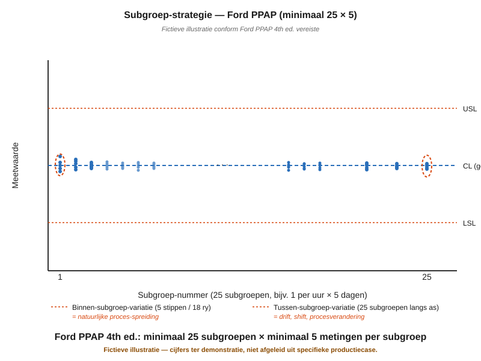

# Wanneer is een subgroep rationeel?

Op je werkplek zie je regelkaarten die "alles groen" aangeven terwijl er wél iets speelt op de lijn — een caviteit die drift, een ploeg die anders instelt, een materiaalbatch die afwijkt. Vaak ligt dat niet aan de kaart zelf, maar aan wat er in de subgroepen gestopt wordt.

## Wat leer je?

Je leert herkennen wanneer een subgroep **rationeel** is — en wanneer je per ongeluk verschillende bedrijfstoestanden door elkaar mengt. Daarmee weet je waarom je kaart soms niet waarschuwt, en hoe je dat oplost.

## De centrale zin

> **Een goede kaart begint vóór het plotten — bij de vraag wát je samenvoegt.**

Een rationele subgroep is een **kleine set eenheden**:

- Onder vrijwel **dezelfde omstandigheden** gemaakt
- **Dicht in de tijd** verzameld
- Bij voorkeur uit dezelfde caviteit, lijn, machine of ploeg

## Waarom dit werkt

Een regelkaart moet twee soorten variatie uit elkaar houden:

| Variatiebron | Waar moet die zichtbaar worden? |
|--------------|----------------------------------|
| Kortetermijn-variatie (gewone ruis) | **Binnen** de subgroep |
| Shifts, drift, verstoringen | **Tussen** subgroepen |

Als je dat omdraait door verkeerd te subgroeperen, krijg je het tegenovergestelde:

- Subgroep over meerdere shifts → control limits worden kunstmatig **breed**
- Subgroep over meerdere caviteiten → caviteit-verschillen verdwijnen in "ruis"
- Subgroep over setup-condities → setup-effecten worden onzichtbaar

**Resultaat:** de kaart geeft geen alarmen meer, ook niet bij echte verstoringen.

## Vier veelgemaakte fouten

| # | Fout | Wat gaat er mis? |
|---|------|-------------------|
| 1 | **Subgroep over shifts** | Operator-effecten worden vermengd met procesvariatie. |
| 2 | **Subgroep over caviteiten** | Caviteit-specifieke problemen (bijv. één verstopte koelkanaal) verdwijnen. |
| 3 | **Te kleine n (<3)** | Variatieschatting wordt instabiel, kaart reageert grillig. |
| 4 | **Mengen van setup-condities** | Verschil tussen "vóór setup-wissel" en "erna" wordt "ruis". |

## Branche-normen voor subgroep-grootte

> De getallen hieronder zijn **branche-normen** — afspraken die in de industrie gangbaar zijn. Het zijn geen wiskundige wetten, maar ze geven je een werkbaar startpunt.

| Bron | Aanbeveling |
|------|-------------|
| **NIST / Minitab** (branche-norm) | Initiële studie: 4-5 stuks per uur, ongeveer **100 metingen** of **25 subgroepen** |
| **Ford PPAP** (branche-norm Ford PPAP, automotive) | Capabilitydemonstratie: **minimaal 25 subgroepen** van **minimaal 5** stuks |
| **Snapshot-principe** | Een subgroep = momentopname van het proces in één toestand |

De Ford PPAP-eis is van belang als je voor automotive werkt. Dan wordt jouw kritische maat tijdens de capabilitystudie op deze manier bemeten — daar hoef je zelf geen berekening voor te doen, maar je moet wel snappen waarom die subgroepen niet over ploegen of caviteiten heen mogen lopen.

## Een praktijkvoorbeeld (spuitgieten, fictief)

> *Casus fictief ter illustratie.*

Een spuitgietlijn met 4 caviteiten. De operator meet elk uur 4 stuks — één uit elke caviteit. De operator denkt: "n=4, dat is genoeg voor een X̄-R-kaart."

**Verkeerd:** deze subgroep mengt vier verschillende caviteiten. Als caviteit 3 een drift heeft, verdwijnt dat in de ruis tussen de vier caviteiten. De kaart ziet nooit een alarm, terwijl caviteit 3 wél afwijkt.

**Beter:** meet 4 stuks **uit dezelfde caviteit** per uur. Bijvoorbeeld op rotatie: uur 1 caviteit 1, uur 2 caviteit 2, enzovoort. Of maak vier aparte kaarten — één per caviteit.

## Wanneer escaleren?

| Situatie | Wat doe je? | Aan wie? |
|----------|-------------|----------|
| Kaart geeft nooit alarm maar je ziet op de lijn problemen | Controleer hoe subgroepen worden samengesteld | Teamleider / kwaliteitsdienst |
| Lijn heeft meerdere caviteiten en één gezamenlijke kaart | Vraag of aparte kaarten per caviteit mogelijk zijn | Teamleider |
| Ford PPAP-capabilitystudie loopt en je ziet dat subgroepen over ploegen lopen | Direct melden | Teamleider / kwaliteitsdienst |
| n in de subgroep is 2 of lager | Vraag of er ruimte is voor minimaal 3-5 stuks | Teamleider |

## Na deze sessie

Je kunt:

- Uitleggen wat een rationele subgroep is
- Herkennen wanneer een subgroep meerdere bedrijfstoestanden mengt
- De vier veelgemaakte fouten benoemen (shifts, caviteiten, n<3, setup)
- Voor je eigen lijn beoordelen of de subgroep-opzet rationeel is
- Bij twijfel weten wat je aan je teamleider moet vragen

In de workshop krijg je een puzzel met 4 productiecasussen. Je beoordeelt eerst op gevoel, daarna duiden we samen wat er mis gaat.

---
*Bron: ko-spc-109 (rationele subgroepering); NIST/SEMATECH Handbook; Minitab documentation; Ford PPAP 4th ed.; AIAG SPC Reference Manual | AIMM Module 2 — SPC Train | v1.0*

---

## Werkbladen (Kolb-cyclus)

1. [`wb-01-oefening.md`](./werkbladen/wb-01-oefening.md) — Oefening
2. [`wb-02-reflectie.md`](./werkbladen/wb-02-reflectie.md) — Reflectie
3. [`wb-03-handout.md`](./werkbladen/wb-03-handout.md) — Handout

## Verder

- Onderliggend kennisobject: [`ko-spc-109`](../../kennisbank/spc/regelkaarten/ko-spc-109.md)
- Voor de begeleider: [`trainer.md`](./trainer.md) + [`draaiboek.md`](./draaiboek.md)
