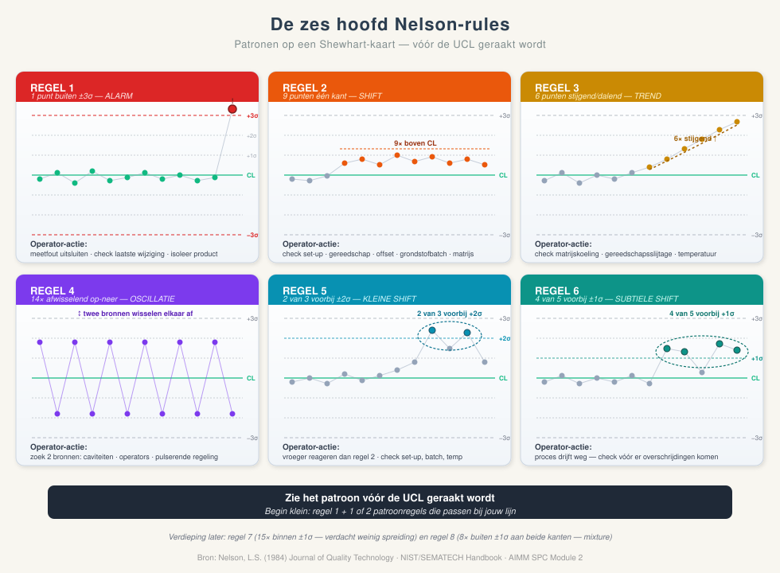

# Welke patronen op je regelkaart vragen om actie?

Een meting buiten de grenzen is duidelijk. Maar de meeste verstoringen verraden zich eerder via patronen dan via één extreem punt. Acht regels — Nelson 1984 — helpen je die patronen te zien.

## Wat leer je?

Je leert de **belangrijkste Nelson-rules** herkennen op een regelkaart en de juiste eerste actie kiezen per patroon. Niet alle 8 tegelijk — gefaseerd, beginnend met de zes hoofdregels.

## Waarom meer dan "punt buiten de grenzen"?

Lloyd Nelson formaliseerde in 1984 acht regels — een uitbreiding op de oudere Western Electric-regels. Elke regel beschrijft een patroon dat statistisch onwaarschijnlijk is bij normale variatie en dus om aandacht vraagt.

## De zes hoofd-regels (start hier)

| Regel | Patroon | Wat het betekent | Eerste actie |
|-------|---------|------------------|--------------|
| **1** | 1 punt buiten ±3σ | Sterke aanwijzing voor verstoring | Meetfout uitsluiten, recente wijziging checken, output veiligstellen, teamleider |
| **2** | 9 punten aan één kant van centrumlijn | Procesgemiddelde lijkt verschoven | Check setup, gereedschap, offset, materiaalbatch, matrijstemperatuur |
| **3** | 6 punten stijgend of dalend | Trend — vaak slijtage of opwarming | Controleer drift: gereedschapsslijtage, temperatuur, drukverlies |
| **4** | 14 punten afwisselend op/neer | Systematische oscillatie | Zoek twee afwisselende oorzaken: twee operators, twee caviteiten, pulserende regeling |
| **5** | 2 van 3 voorbij ±2σ aan één kant | Kleine maar serieuze shift | Reageer sneller dan bij regel 2 — vroege waarschuwing |
| **6** | 4 van 5 voorbij ±1σ aan één kant | Subtielere shift | Controleer of het proces wegdrijft vóór echte overschrijdingen |

## De twee diagnostische regels (later)

Regels 7 en 8 zijn tegenintuïtief en horen bij gevorderd niveau. Ze gaan over **stratificatie** en **mixture** — datapatronen die onthullen dat je per ongeluk meerdere bronnen door elkaar meet. Niet voor deze sessie.

## Gevoeligheid versus vals alarm

Meer regels = sneller verstoringen detecteren, maar ook meer kans op vals alarm. Een operator die door te veel valse alarmen alarmsignalen gaat negeren — dat kost meer dan een gemiste echte verstoring.

Daarom: **gefaseerd toepassen**.
- Beginner: regels 1 en 2.
- Gevorderd: regels 3, 4, 5, 6 erbij.
- Expert: regels 7 en 8 — alleen bij goed begrip van rationele subgroepering.

## Een concreet voorbeeld

Op een spuitgietlijn meet de operator gewicht elke 10 minuten. Na twee uur ziet hij **6 punten stijgend** (regel 3): 99,8 → 99,85 → 99,9 → 99,95 → 100,0 → 100,05 g. Geen enkel punt is buiten de grenzen.

Hij controleert de matrijskoeling — die blijkt deels verstopt. De pers liep langzaam warmer en duwde meer materiaal in de matrijs. Zonder regel 3 had hij pas bij overschrijding van UCL (regel 1) ingegrepen — uren later, met afkeur tot gevolg.

## Onderscheid met andere bronnen

- **Western Electric** — compactere set (4 hoofdregels). Klassiek.
- **Nelson** — uitgebreider en didactisch rijker (8 regels).
- **AIAG/automotive** — vaak een beperkte set + strikte reaction plans.

## Na deze sessie

Je kunt:
- Minimaal 4 van de 6 hoofd-Nelson-regels herkennen op een regelkaart
- Per patroon de juiste eerste actie benoemen
- Uitleggen waarom een gefaseerde aanpak de beste keuze is voor operator-onderwijs

In de workshop oefen je met een patroonquiz: 6 fictieve regelkaarten waar je het patroon mag benoemen — voordat je de theorie krijgt.

---

## Werkbladen (Kolb-cyclus)

1. [`wb-01-patroonquiz.md`](./werkbladen/wb-01-patroonquiz.md) — Patroonquiz
2. [`wb-02-reflectie.md`](./werkbladen/wb-02-reflectie.md) — Reflectie
3. [`wb-03-handout-zes-regels.md`](./werkbladen/wb-03-handout-zes-regels.md) — Handout zes regels
4. [`wb-03-nelson-handout.md`](./werkbladen/wb-03-nelson-handout.md) — Nelson handout
5. [`wb-04-eigen-kaart-analyse.md`](./werkbladen/wb-04-eigen-kaart-analyse.md) — Eigen kaart analyse

## Verder

- Onderliggend kennisobject: [`ko-spc-201`](../../kennisbank/spc/regelkaarten/ko-spc-201.md)
- Voor de begeleider: [`trainer.md`](./trainer.md) + [`draaiboek.md`](./draaiboek.md)
