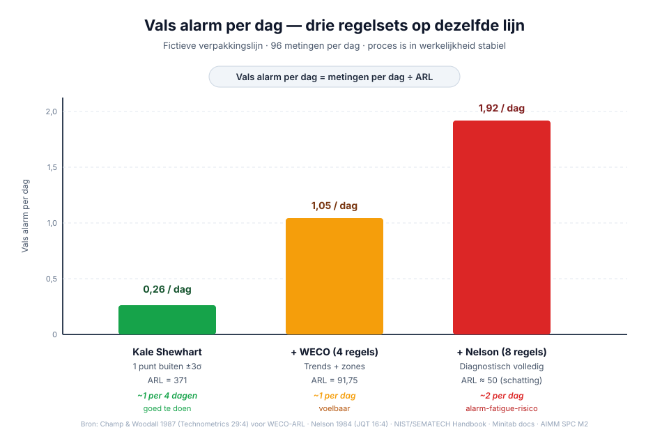

# Waarom levert méér signaalregels niet automatisch een betere regelkaart op?

Op je werkplek gaat regelmatig een alarm af op een regelkaart of dashboard. Soms blijkt het niets te zijn — dat noemen we een **vals alarm**. Frustrerend: de lijn stopt, jij loopt ernaartoe, en er is niks aan de hand. Waarom gebeurt dat? En waarom staat op de ene lijn een gevoeligere regelset dan op de andere?

## Wat leer je?

Je leert de afweging herkennen tussen **gevoeligheid** (snel een echt probleem zien) en **vals alarm** (alarm zonder echt probleem). Je leert rekenen met **ARL** — Average Run Length — zodat je weet hoeveel vals alarm je per dag mag verwachten bij elke regelset.

## De centrale zin

> **Elke extra signaalregel maakt je regelkaart gevoeliger — maar ook vaker vals.**
> Te veel regels = alarm-fatigue. Operators gaan signalen negeren.

## Wat is ARL?

**ARL** staat voor **Average Run Length**: gemiddeld aantal metingen tot er een alarm afgaat — terwijl het proces in werkelijkheid stabiel is. Hoe hoger de ARL, hoe minder vals alarm.

Denk aan ARL als: *hoe vaak "loos alarm" per hoeveel metingen?*

## De drie regelsets — en hun vals-alarmfrequentie

| Regelset | Wat doet het? | ARL (vals alarm na ~X metingen) |
|----------|---------------|---------------------------------|
| **Kale Shewhart** | Alleen alarm als 1 punt buiten ±3σ valt | **~371 metingen** |
| **+ WECO (4 extra regels)** | Let ook op trends en zones | **~91,75 metingen** |
| **+ Volledige Nelson (8 regels)** | Uitgebreide diagnostische regels | **Aanzienlijk vaker** |

> Het ARL-getal **91,75** voor WECO komt uit Champ & Woodall (1987, Technometrics) — niet uit NIST zoals vaak foutief geciteerd. Wil je het getal ergens doorgeven: noem Champ & Woodall.

## Een concreet voorbeeld

Stel: een verpakkingslijn meet elke 5 minuten. De lijn draait 8 uur per dag. Dat is **96 metingen per dag**.

- **Kale Shewhart** (ARL = 371): 371 / 96 ≈ 3,9 → ~**1 vals alarm per 4 dagen**. Goed te doen.
- **+ WECO** (ARL = 91,75): 91,75 / 96 ≈ 0,96 → ~**1 vals alarm per dag**. Voelbaar.
- **+ Volledige Nelson**: meerdere valse alarmen per dag. Alarm-fatigue-risico.

> *Fictieve case — bedoeld voor rekenoefening, niet gebaseerd op een echte lijn.*

## Waarom is "meer is beter" een val?

Drie redenen waarom méér regels niet automatisch beter is:

1. **Alarm-fatigue** — operators die continu vals alarm krijgen, gaan *alle* alarmen serieuzer nemen of juist negeren. Het werkt averechts.
2. **Verloren productietijd** — elke keer dat het alarm afgaat, stopt de lijn of loopt iemand ernaartoe. Een vals alarm kost écht geld.
3. **Verloren vertrouwen in de kaart** — als het systeem "te vaak zomaar alarm geeft", gaan operators het systeem wantrouwen. En dan is het kwijt.

> Minitab pleit in dezelfde geest voor **beperkte inzet van regels**: liever drie regels die je begrijpt dan acht die je negeert.

## De gefaseerde aanpak bij AIMM

Daarom leren we signaalregels **gefaseerd** — niet alles tegelijk:

| Module | Regels | Waarom hier? |
|--------|--------|--------------|
| **Module 1 — Gebruik** | Regel 1 + 2 | Basisstabiliteit. Je leert de kaart lezen. |
| **Module 2 — Train** (deze sessie) | Regels 3–6 | Trend- en mixsignalen. Je leert wat die regels toevoegen en wat ze kosten. |
| **Module 3 — Op Maat** | Regels 7–8 | Diagnostische verdieping. Alleen bij goed begrip van subgroepering. |

Die volgorde is geen toeval — het voorkomt dat je te snel te veel tegelijk aan zet.

## Wanneer is dit voor jou belangrijk?

- Je ziet op je dashboard regelmatig alarm afgaan. Je vraagt je af: *is dit echt of niet?*
- Engineering stelt voor om meer regels aan te zetten. Jij wil meepraten: *maakt het ons werk makkelijker of juist moeilijker?*
- Je hebt het gevoel dat je collega's alarmen gaan negeren. Dit is alarm-fatigue — een echt probleem, niet een slechte mentaliteit.

## Wanneer escaleer je?

- Als je vermoedt dat jouw lijn te veel vals alarm krijgt (bijvoorbeeld meerdere per dag): vraag teamleider of engineering welke regelset actief is.
- Als er wordt voorgesteld "alles aan te zetten" zonder uitleg: vraag om de afweging tussen gevoeligheid en vals alarm uit te leggen.
- Bij twijfel: de gefaseerde aanpak is een goed gesprek om te beginnen.

## Na deze sessie

Je kunt:
- Uitleggen wat ARL is en wat 371 en 91,75 betekenen
- Voor je eigen lijn uitrekenen hoeveel vals alarm je per dag zou verwachten
- Benoemen waarom alarm-fatigue een echt productierisico is
- Meepraten over de afweging tussen gevoeligheid en vals alarm

In de workshop reken je eerst zelf de drie scenario's door (kale Shewhart, + WECO, + Nelson). Daarna kijk je terug op je eigen ervaring met vals alarm. Pas daarna bespreken we de theorie.

---
*Bron: ko-spc-202; NIST/SEMATECH Engineering Statistics Handbook; Champ & Woodall (1987) Technometrics; Minitab documentation | AIMM Module 2 — SPC Train | v1.0*

---

## Werkbladen (Kolb-cyclus)

1. [`wb-01-oefening.md`](./werkbladen/wb-01-oefening.md) — Oefening
2. [`wb-02-reflectie.md`](./werkbladen/wb-02-reflectie.md) — Reflectie
3. [`wb-03-handout.md`](./werkbladen/wb-03-handout.md) — Handout

## Verder

- Onderliggend kennisobject: [`ko-spc-202`](../../kennisbank/spc/regelkaarten/ko-spc-202.md)
- Voor de begeleider: [`trainer.md`](./trainer.md) + [`draaiboek.md`](./draaiboek.md)
