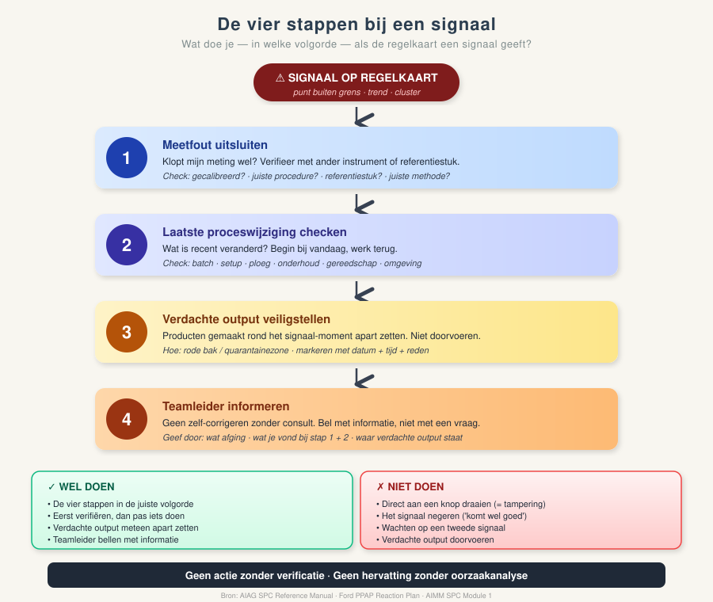

# Wat doe je als de regelkaart een signaal geeft?

Vroeg of laat zie je een meting die er uitspringt. Wat is je eerste reactie? Snel iets bijstellen? Of eerst kijken wat er aan de hand is? Dit gaat over de vier stappen die je dan zet — in de juiste volgorde.

## Wat leer je?

Je leert wat je doet bij een **out-of-control signaal**: een meting buiten de grenzen of een patroon dat aandacht vraagt. Vier stappen, geen omweg.

## De vier stappen

### Stap 1: Sluit een meetfout uit

Een signaal is alleen geldig als de meting klopt. Check eerst:
- Is het meetinstrument gecalibreerd?
- Is er volgens procedure gemeten?
- Is er een referentiestuk om opnieuw te meten?
- Klopt de meetmethode?

Als de meting fout was: documenteer en herstart het meten. **Niet** ingrijpen op het proces.

### Stap 2: Check de laatste proceswijziging

Wat is er **recent** veranderd?
- Nieuwe materiaalbatch
- Setup-wissel
- Andere ploeg
- Onderhoud uitgevoerd
- Nieuw of bijgeslepen gereedschap
- Veranderde temperatuur of vocht

### Stap 3: Stel verdachte output veilig

Producten gemaakt **rond het signaal-moment** (en bij voorkeur sinds het laatste in-control punt) moeten apart in een rode bak. Niet doorvoeren naar de volgende processtap tot vrijgave.

### Stap 4: Informeer de teamleider

Geen pogingen tot zelf-corrigeren zonder consultatie. De teamleider beslist:
- Doorgaan na verificatie?
- Lijn stilleggen?
- Engineering inschakelen?
- 100 % inspectie van de verdachte output?

## Wat je NIET doet

- Niet zomaar het proces "terugduwen" naar het gemiddelde — dat is tampering (zie de vorige les).
- Niet het signaal negeren omdat "het zo wel goed komt".
- Niet wachten tot meerdere signalen verschijnen.
- Niet alleen de meetwaarde aanpassen in het systeem.

## Documentatie hoort erbij

Elke signaal-respons leg je vast:
- Datum, tijd, kaart, welke regel afging
- Genomen acties
- Gevonden oorzaak (of: nog onbekend)
- Vrijgave-besluit verdachte output

Deze logs zijn cruciaal voor patroonanalyse op teamleider-niveau. Zonder log: je leert er niets van.

## Een concreet voorbeeld

Operator Daan meet om 13:45 een waarde buiten UCL op zijn X̄-R-kaart. Hij doet:

1. Hij meet hetzelfde stuk opnieuw met een ander instrument → dezelfde uitslag (meetfout uitgesloten).
2. Hij checkt: om 13:30 is een nieuwe materiaalbatch geladen (wijziging gevonden).
3. Hij zet alle producten gemaakt sinds 13:30 apart in een rode bak.
4. Hij belt teamleider Yasmin.

Yasmin besluit: 100 % inspectie van de rode bak, materiaalbatch in quarantaine voor leverancier-onderzoek, lijn doorlaten met monsters van de vorige batch tot validatie.

## Na deze sessie

Je kunt:
- De vier stappen op volgorde uitvoeren bij een signaal
- Verdachte output veiligstellen vóór escalatie
- De juiste mensen op het juiste moment betrekken

In de workshop oefen je dit met een signaalcasus en vul je voor je eigen lijn een reactieplan in: weet je wie je belt, en weet je waar je de rode bak hebt staan?

---

## Werkbladen (Kolb-cyclus)

1. [`wb-01-signaalcasus.md`](./werkbladen/wb-01-signaalcasus.md) — Signaalcasus
2. [`wb-02-reflectie.md`](./werkbladen/wb-02-reflectie.md) — Reflectie
3. [`wb-02-starrt-reflectie.md`](./werkbladen/wb-02-starrt-reflectie.md) — Starrt reflectie
4. [`wb-03-handout-vier-stappen.md`](./werkbladen/wb-03-handout-vier-stappen.md) — Handout vier stappen
5. [`wb-03-vier-stappen-handout.md`](./werkbladen/wb-03-vier-stappen-handout.md) — Vier stappen handout
6. [`wb-04-eigen-reactieplan.md`](./werkbladen/wb-04-eigen-reactieplan.md) — Eigen reactieplan

## Verder

- Onderliggend kennisobject: [`ko-spc-203`](../../kennisbank/spc/regelkaarten/ko-spc-203.md)
- Voor de begeleider: [`trainer.md`](./trainer.md) + [`draaiboek.md`](./draaiboek.md)
