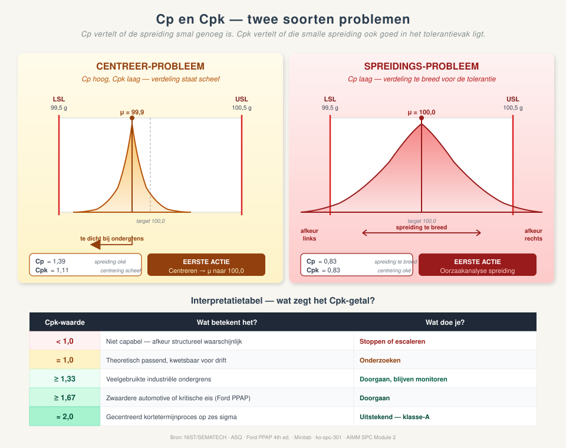

# Wat zegt een Cpk-getal je écht over je lijn?

Op je werkplek zie je rapporten met Cpk-getallen voorbijkomen. Een Cpk van 0,9 lijkt op het eerste gezicht "iets met die machine doen", maar misschien hoef je alleen te centreren en is je spreiding prima. Andersom kan een Cpk van 1,2 lijken alsof het redelijk gaat, terwijl het op een kritisch onderdeel net niet voldoet.

## Wat leer je?

Je leert het verschil lezen tussen **Cp** en **Cpk** — en daarmee weten welk type probleem je voor je hebt: is het een spreidings-probleem of een centrering-probleem? Daarna kies je een passende eerste actie.

## De centrale zin

> **Cp** vertelt of de spreiding **smal genoeg** is.
> **Cpk** vertelt of die smalle spreiding ook **goed in het tolerantievak ligt**.

Een proces kan dus een aardige Cp hebben (smal genoeg) en toch een lage Cpk (te dicht tegen één van de tolerantiegrenzen).

## De twee formules

| Index | Formule | Wat het zegt |
|-------|---------|--------------|
| Cp | (USL − LSL) / (6σ) | Is de spreiding smal genoeg? (Potentieel) |
| Cpk | min[(USL−μ)/3σ, (μ−LSL)/3σ] | Past die spreiding ook werkelijk in het tolerantievak? (Werkelijke prestatie) |

Je hoeft deze formules niet uit je hoofd te kennen. Je moet de uitslag kunnen lezen en weten wat je ermee doet.

## Industriële vuistregels

| Cp / Cpk | Interpretatie |
|----------|---------------|
| < 1,0 | Niet capabel — afkeur structureel waarschijnlijk |
| = 1,0 | Theoretisch passend, kwetsbaar voor drift |
| ≥ 1,33 | Industriële ondergrens |
| ≥ 1,67 | Zwaardere automotive eis (Ford PPAP) |
| ≈ 2,0 | Gecentreerd kortetermijnproces op zes sigma |

## Een concreet voorbeeld (spuitgieten)

Onderdeelgewicht moet tussen 99,5 en 100,5 g liggen. Stabiele lijn: gemiddeld 99,9 g, σ = 0,12 g.

- **Cp** = (100,5 − 99,5) / (6 × 0,12) ≈ **1,39** → spreiding lijkt in potentie goed.
- **Cpk** = min[(100,5 − 99,9)/0,36 ; (99,9 − 99,5)/0,36] = min[1,67 ; 1,11] = **1,11** → de pers staat te dicht tegen de **ondertolerantie** aan.

**De les voor de operator**: de pers schiet niet "te wijd". De spreiding is OK. Het gemiddelde staat scheef. De juiste actie is dus **centreren** (gemiddelde naar 100,0 g), niet harder proberen de spreiding te verkleinen.

## Wanneer is Cpk berekenen NIET zinvol?

Drie veelgemaakte fouten maken Cpk-getallen waardeloos:

1. **Capability rekenen op een instabiel proces** — eerst SPC-kaart valideren dat het proces stabiel is, dan pas Cpk.
2. **Slechte subgroepering** — subgroepen die meerdere shifts of caviteiten mengen vermengen kortetermijn- en langetermijnvariatie.
3. **Slecht meetsysteem** — als de meetfout groot is, zegt Cpk evenveel over de meter als over de machine. Eerst Gage R&R, dan capability.

## Wanneer escaleren?

- Cpk < 1,33 én procesgemiddelde gecentreerd: vraag teamleider/engineering om naar de spreiding te kijken (machine-onderhoud, materiaalspecificatie).
- Cpk laag maar Cp goed: zelf centreren als je daartoe bevoegd bent, anders teamleider.
- Bij twijfel over stabiliteit of meetkwaliteit: altijd escaleren.

## Na deze sessie

Je kunt:
- Het verschil benoemen tussen Cp en Cpk
- Een Cpk-getal koppelen aan een interpretatie via de tabel
- Een centrering-probleem onderscheiden van een spreidings-probleem
- Voor je eigen lijn opzoeken (of vragen) wat de huidige Cpk is

In de workshop krijg je een Cpk-puzzel met 4 productiecasussen. Je gokt eerst, daarna duiden we ze samen.

---

## Werkbladen (Kolb-cyclus)

1. [`wb-01-cpk-puzzel.md`](./werkbladen/wb-01-cpk-puzzel.md) — Cpk puzzel
2. [`wb-02-reflectie.md`](./werkbladen/wb-02-reflectie.md) — Reflectie
3. [`wb-03-cpk-handout.md`](./werkbladen/wb-03-cpk-handout.md) — Cpk handout
4. [`wb-04-eigen-cpk-analyse.md`](./werkbladen/wb-04-eigen-cpk-analyse.md) — Eigen cpk analyse

## Verder

- Onderliggend kennisobject: [`ko-spc-301`](../../kennisbank/spc/procesbekwaamheid/ko-spc-301.md)
- Voor de begeleider: [`trainer.md`](./trainer.md) + [`draaiboek.md`](./draaiboek.md)
