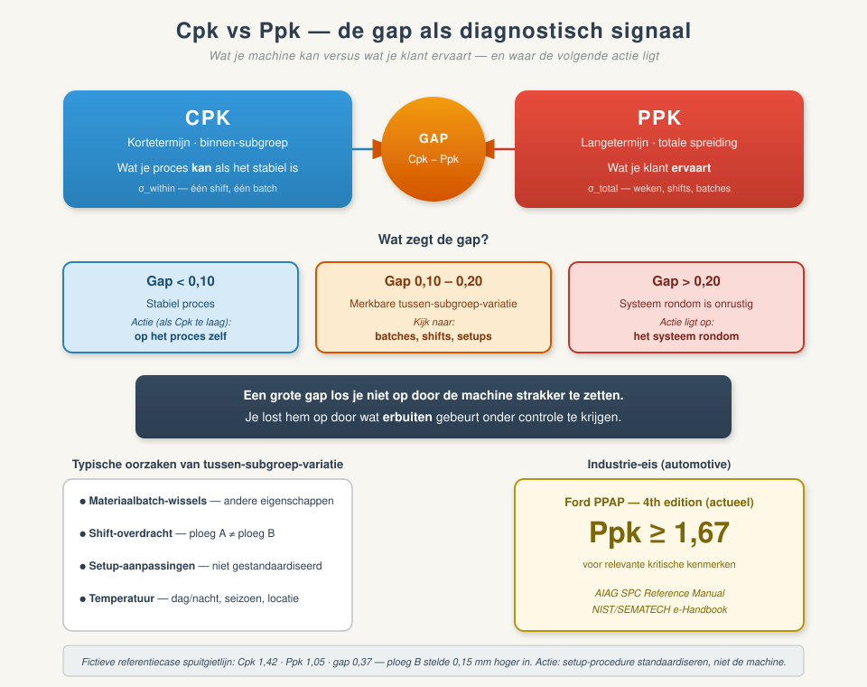

# Pp en Ppk op jouw lijn: wat ervaart je klant écht?

Je Cpk staat keurig boven 1,33. Toch krijg je klachten. Of je hoort "we gaan PPAP doen" en vraagt je af of jouw lijn dat wel haalt. Deze sessie helpt je het verschil tussen **Cpk** en **Ppk** inzetten als diagnose op je eigen lijn — en één concrete actie plannen voor komende week.

## Wat leer je?

Je leert voor **één concrete eigen lijn**:
- Cpk en Ppk naast elkaar leggen
- De gap tussen beide interpreteren als diagnostisch signaal
- Beslissen of de actie ligt op het **proces zelf** of op het **systeem rondom**

## Cpk vs Ppk — waarom twee getallen?

| Index | Spreiding | Wat het meet |
|-------|-----------|--------------|
| **Cp / Cpk** | Binnen-subgroep (kortetermijn) | Wat het proces **kan** als het stabiel is |
| **Pp / Ppk** | Totale spreiding (langetermijn) | Wat de **klant uiteindelijk ervaart** |

Binnen één shift kan alles er goed uitzien. Maar tussen shifts, batches en setups schuift er iets. Dat "tussen-subgroep"-verschil telt wel mee in Ppk, niet in Cpk.

**Bijna altijd: Cpk ≥ Ppk.** Hoe groter het verschil, hoe onstabieler je lange termijn.

## De gap als diagnose

| Gap (Cpk − Ppk) | Wat zegt het? | Waar ligt de actie? |
|------------------|---------------|---------------------|
| **< 0,10** | Stabiel proces, weinig tussen-subgroep-variatie | Op het proces zelf (als Cpk te laag) |
| **0,10 – 0,20** | Merkbare tussen-subgroep-variatie | Kijk naar batches, shifts, setups |
| **> 0,20** | Groot gat — systeem rondom proces is onrustig | Op het systeem rondom: setup-procedure, shift-overdracht, batch-discipline |

**Kern:** een grote gap los je niet op door de machine strakker te zetten. Je lost hem op door wat erbuiten gebeurt onder controle te krijgen.

## Typische oorzaken van een grote gap

- **Materiaalbatch-wissels** — nieuwe batch, iets andere eigenschappen
- **Shift-overdracht** — ploeg A en ploeg B stellen net anders in
- **Setup-aanpassingen** — wisseltijd tussen orders niet gestandaardiseerd
- **Temperatuur** — dag/nacht-verschil, seizoen, locatie op de vloer

## Ford PPAP en AIAG — de industrie-eis

Voor automotive-leveranciers staat de eis zwart-op-wit:

- **Ford PPAP (4th edition)** eist **Ppk ≥ 1,67** voor relevante kritische kenmerken
- **AIAG SPC Reference Manual** geeft vergelijkbare drempels per kritisch kenmerk
- **General Motors, VW** eisen vaak hetzelfde of strenger

**Waarom zo streng?** Omdat de klant de langetermijn-realiteit ervaart, niet één mooie shift. Een Ppk van 1,67 betekent dat ook mét shifts, batches en temperatuurverschillen meegerekend, er ruimte blijft tot de tolerantiegrens.

## Operator-rol vs teamleider-rol

| Taak | Operator (MBO-4) | Teamleider (MBO-4) |
|------|------------------|---------------------|
| Baseline-data leveren | Meetgegevens eerlijk registreren | Data-export organiseren uit MES/kwaliteit |
| Cpk/Ppk aflezen | Uit rapport halen | Berekenen of laten berekenen |
| Oorzaak-hypothese | Patronen op de vloer herkennen | Stratificatie per shift/batch maken |
| Actie op systeem rondom | Afwijking bij shift-overdracht melden | Setup-procedure herzien, shift-afspraak maken |

## Een concreet voorbeeld *(fictieve referentiecase, op basis van veldervaring)*

Een spuitgietlijn meet over een week:

- **Cpk = 1,42** — binnen elke shift goed
- **Ppk = 1,05** — over de hele week onvoldoende
- **Gap = 0,37** — groot

Onderzoek wijst uit: ploeg B stelt de machine systematisch 0,15 mm hoger in dan ploeg A. Binnen elke shift is het proces stabiel (goede Cpk), maar de wissel zorgt voor drift over de week (lage Ppk).

**Actie:** niet het proces zelf aanpakken, maar:
- Set-up-procedure standaardiseren per ploeg
- Ploeg B trainen op de juiste instelling
- SPC-kaart met stratificatie per ploeg inrichten

Na twee maanden: Ppk omhoog naar 1,48. Ford PPAP-eis van 1,67 nog niet gehaald — volgende stap ingepland.

## Wanneer ga je door naar DMAIC?

Als je gap > 0,20 is én je Ppk niet haalt wat de klant eist: dit is een DMAIC-kandidaat. Zie lo-spc-402 voor hoe je dat als verbeterproject opzet.

## Wat is je eigen scope?

Voor deze sessie — kies één lijn waar:
- Je een klantkritische maat hebt (USL/LSL bekend)
- Je minimaal een week data hebt uit **meerdere** shifts of batches
- Je vermoedt dat de Cpk er beter uitziet dan de klantervaring suggereert
- Je komende week één observatie kunt doen

## Na deze sessie

Je kunt:
- Cpk en Ppk naast elkaar leggen voor je eigen lijn
- De gap interpreteren als diagnostisch signaal
- Ford PPAP Ppk ≥ 1,67 toetsen voor jouw kritische maat
- Onderscheiden of actie op het proces of op het systeem rondom ligt
- Één concrete maandag-actie plannen

In de workshop vul je een eigen-analyse-werkblad (wb-01), doe je STARRT-reflectie met peer-check (wb-02), en gebruik je de handout (wb-03) als naslag.

---

*Bron: ko-spc-302 (Pp/Ppk). Industriële drempels: Ford PPAP 4th edition, AIAG SPC Reference Manual. Statistische definities: NIST/SEMATECH e-Handbook of Statistical Methods. Het spuitgiet-voorbeeld is een fictieve referentiecase gebaseerd op veldervaring.*

---

## Werkbladen (Kolb-cyclus)

1. [`wb-01-eigen-analyse.md`](./werkbladen/wb-01-eigen-analyse.md) — Eigen analyse
2. [`wb-02-reflectie.md`](./werkbladen/wb-02-reflectie.md) — Reflectie
3. [`wb-03-handout.md`](./werkbladen/wb-03-handout.md) — Handout

## Verder

- Onderliggend kennisobject: [`ko-spc-302`](../../kennisbank/spc/procesbekwaamheid/ko-spc-302.md)
- Voor de begeleider: [`trainer.md`](./trainer.md) + [`draaiboek.md`](./draaiboek.md)
