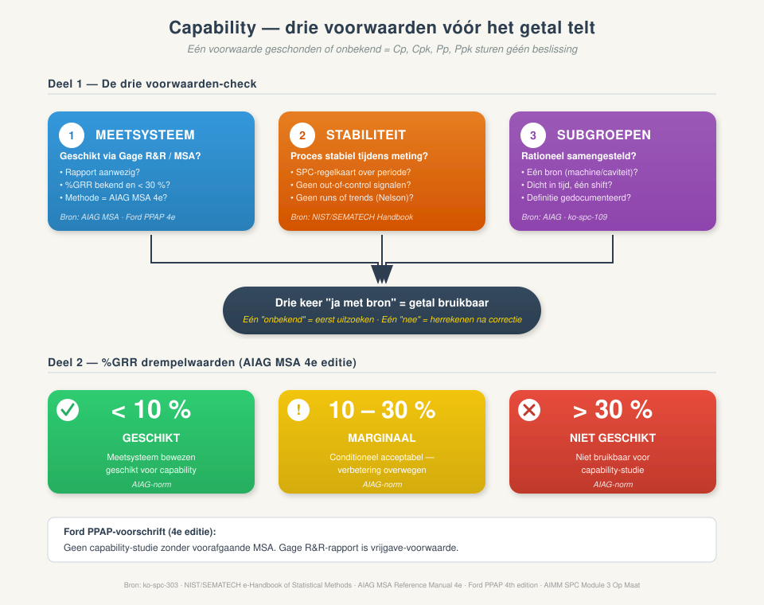

# Hoe weet jij of een Cpk-getal betrouwbaar is?



Een teamleider rapporteert: *"Cpk = 1,5 voor onze nieuwe productlijn."* Klinkt goed. Maar is dat getal te vertrouwen? Kun je er een investering- of vrijgave-beslissing op baseren? Niet automatisch. Een capability-getal zegt pas iets als drie voorwaarden zijn gecheckt.

## Wat leer je?

Je leert een gerapporteerd capability-getal (Cp, Cpk, Pp, Ppk) **kritisch toetsen** aan drie voorwaarden — zodat je weet wanneer een getal bruikbaar is voor beslissingen en wanneer het eerst verder onderzoek vraagt.

## De drie valkuilen

Uit het kennisobject: Cpk kan om drie redenen een misleidend getal opleveren.

| # | Valkuil | Gevolg | Wat eist de standaard? |
|---|---------|--------|-----------------------|
| **1** | Capability rekenen op een **instabiel proces** | σ is een mix van normale variatie + verstoringen; morgen ander getal | NIST/SEMATECH Handbook: eerst stabiliteit via SPC-regelkaart |
| **2** | **Slechte subgroepering** (shifts, recepten, caviteiten door elkaar) | Cp/Cpk te conservatief óf te optimistisch geschat | AIAG: rationele subgroepen — zelfde omstandigheden, dicht in tijd |
| **3** | **Slecht meetsysteem** | Cpk zegt evenveel over de meter als over de machine | Ford PPAP eist Gage R&R / AIAG MSA vóór capability |

## De juiste volgorde

```
1. Meetsysteem geschikt?   (Gage R&R / MSA volgens AIAG)
        ↓ Ja
2. Proces stabiel?          (SPC-regelkaart — geen out-of-control signalen)
        ↓ Ja
3. Verdeling redelijk?      (normaliteit-check)
        ↓ Ja
4. Capability berekenen     (Cp, Cpk, Pp, Ppk)
        ↓
5. Pas dán beslissingen nemen op basis van getallen
```

Elke stap overgeslagen = elke beslissing minder onderbouwd.

## Herken je dit? — De fictieve case

> *Fictieve case ter illustratie.* Een lijnmanager rapporteert "Cpk = 1,5 voor onze nieuwe productlijn". Een kritische teamleider stelt drie vragen:
>
> 1. **"Was het proces stabiel toen je dit berekende?"**
>    → "We hebben 100 metingen genomen over 3 dagen." → Maar was er een regelkaart die geen out-of-control signalen gaf?
>
> 2. **"Hoe waren de subgroepen?"**
>    → "Vijf metingen per uur, vier caviteiten door elkaar." → Caviteit-effecten zitten in σ — Cpk is mogelijk onderschat.
>
> 3. **"Is het meetsysteem gevalideerd?"**
>    → "We gebruiken de standaard schuifmaat." → Gage R&R is niet gedaan — de getallen kunnen voor 30% meetfout bevatten.
>
> **Conclusie:** het getal 1,5 is misschien correct, maar zonder antwoord op deze drie vragen weet niemand het. **Eerst valideren, dán beslissingen nemen.**

## De drie vragen die jij voortaan stelt

Bij elk Cpk-getal dat op je bureau komt:

1. **Meetsysteem** — *Is er een geldig Gage R&R / MSA-rapport (AIAG-methode)?*
2. **Stabiliteit** — *Toonde de SPC-regelkaart over de meetperiode geen out-of-control signalen?*
3. **Subgroepering** — *Waren de subgroepen rationeel (zelfde machine, zelfde caviteit, zelfde shift, zelfde recept)?*

Drie keer "ja met bron" = het getal is bruikbaar.
Eén keer "onbekend" = eerst uitzoeken vóór je beslist.

## Waarom Ford PPAP dit eist

Ford's *Production Part Approval Process* (PPAP 4th edition) schrijft expliciet voor: **geen capability-studie zonder voorafgaande MSA** (Measurement System Analysis). AIAG's MSA Reference Manual beschrijft de methode (Gage R&R: Repeatability + Reproducibility). NIST/SEMATECH voegt toe: stabiliteit is de voorwaarde waaronder de formules überhaupt geldig zijn.

Dit zijn geen academische subtiliteiten. Het is de reden dat automotive-leveranciers al decennia MSA vóór capability doen — fouten hier hebben miljoenenconsequenties.

## Operator-rol vs teamleider-rol

| Voorwaarde | Wat doet de operator? | Wat doet de teamleider? |
|-----------|------------------------|--------------------------|
| **Meetsysteem** | Meet consistent volgens instructie; rapporteert onzekerheid eerlijk | Vraagt Gage R&R op bij kwaliteit; plant studie bij meterwissel |
| **Stabiliteit** | Bewaakt regelkaart; rapporteert signalen | Beoordeelt stabiliteit vóór capability; vraagt regelkaart-uitdraai |
| **Subgroepering** | Weet welke subgroep hij meet | Definieert rationele subgroepen (zie ko-spc-109) |

## Wat is je eigen scope?

Voor deze workshop: neem één gerapporteerd capability-getal mee — uit een kwaliteitsrapport, MES-export, klantaudit-dossier of teamdashboard. Je gaat dat getal langs de drie voorwaarden leggen. Aan het eind heb je drie vragen klaar voor de rapporteur én één concrete maandag-actie.

## Na deze sessie

Je kunt:
- Een Cpk-getal niet meer klakkeloos accepteren of afwijzen
- De drie voorwaarden (meetsysteem / stabiliteit / subgroepering) concreet toetsen
- De juiste vragen stellen aan wie het getal heeft berekend
- Voorkomen dat investeringen naar de verkeerde plek gaan (nieuwe machine terwijl het meetsysteem het probleem was)

---

*Bronnen: ko-spc-303; NIST/SEMATECH e-Handbook of Statistical Methods; AIAG Measurement Systems Analysis Reference Manual (4e); Ford Production Part Approval Process (PPAP 4th edition); Minitab documentation. | AIMM Module 3 — SPC Op Maat | v1.0*

---

## Werkbladen (Kolb-cyclus)

1. [`wb-01-eigen-analyse.md`](./werkbladen/wb-01-eigen-analyse.md) — Eigen analyse
2. [`wb-02-reflectie.md`](./werkbladen/wb-02-reflectie.md) — Reflectie
3. [`wb-03-handout.md`](./werkbladen/wb-03-handout.md) — Handout

## Verder

- Onderliggend kennisobject: [`ko-spc-303`](../../kennisbank/spc/procesbekwaamheid/ko-spc-303.md)
- Voor de begeleider: [`trainer.md`](./trainer.md) + [`draaiboek.md`](./draaiboek.md)
