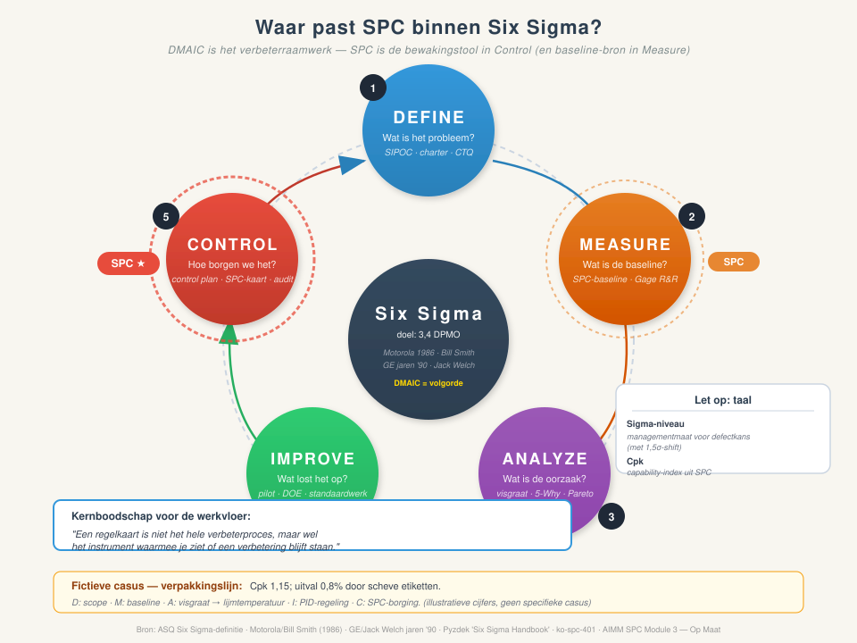

# Waar houdt SPC op en waar begint Six Sigma?

Je werkt al met regelkaarten en Cpk. Soms zie je op een kaart dat er iets structureel mis is — en dan stokt het. De kaart laat het signaal zien, maar lost niets op. Dan hoor je termen vallen: "We moeten er een Six Sigma-project van maken." Of: "DMAIC erop zetten." Wat betekent dat eigenlijk, en waar past jouw SPC-werk daarin?

## Wat leer je?

Je leert wat **Six Sigma** is, waar het vandaan komt, en vooral: hoe het zich verhoudt tot **SPC**. Aan het eind kun je één lopend vraagstuk op je eigen lijn positioneren in het bredere verbeterplaatje.

## Six Sigma in één alinea

Six Sigma is een **data-gedreven verbeterbenadering** die procesvariatie reduceert. Het numerieke doel is beroemd: **3,4 defects per million opportunities (DPMO)** — een 6σ-prestatieniveau. Het ontstond in **1986 bij Motorola** (Bill Smith) en werd in de **jaren '90 door General Electric** (Jack Welch) wereldwijd populair. Sindsdien is het management-mainstream (ASQ).

## Let op: "sigma-niveau" is niet hetzelfde als Cpk

Dit is een valkuil waar veel operators over struikelen. De bekende 3,4 DPMO hoort bij een **1,5σ-shift-aanname** — Six Sigma rekent met een verschuiving van het procesgemiddelde in de loop van de tijd. Daardoor is "zes sigma" in Six Sigma-taal **niet** identiek aan de zuivere kortetermijnkans van een perfect gecentreerde normale verdeling.

De praktische boodschap:

> **Sigma-niveau is in Six Sigma een managementmaat voor defectkans — niet simpelweg een synoniem voor Cpk.**

Cpk is een capability-index die je uit SPC-data rekent. Sigma-niveau is een bredere kwaliteitstaal die management gebruikt. Haal ze niet door elkaar in gesprekken met je kwaliteitscoördinator.

## Hoe verhouden SPC en Six Sigma zich?

Kort antwoord: **SPC is geen concurrent van Six Sigma — SPC is een deelverzameling ervan.**

| Aspect | SPC | Six Sigma |
|--------|-----|-----------|
| **Scope** | Procesbewaking | Volledig verbeterproject |
| **Tools** | Regelkaarten, Cpk, p-kaarten | DMAIC + SPC + FMEA + DOE + process mapping + MSA |
| **Plaats in DMAIC** | Vooral **Control**-fase (ook als meetbron in Measure) | Het hele Define–Measure–Analyze–Improve–Control |

### DMAIC in één zin

DMAIC is de verbeterroute van Six Sigma: **Define** (wat is het probleem?), **Measure** (wat is de huidige prestatie?), **Analyze** (wat is de oorzaak?), **Improve** (welke verandering helpt?), **Control** (hoe borgen we dat?). Jouw SPC-kaart zit vooral in Control — én levert de baseline-data in Measure.

## De didactische boodschap

> **Een regelkaart is niet het hele verbeterproces, maar wel het instrument waarmee je ziet of een verbetering werkelijk blijft staan.**

Dit is precies de waarde van SPC binnen Six Sigma: SPC ziet of het werkt en of het blijft werken. Six Sigma zorgt dat er een onderbouwde verbetering is om te borgen.

## Welke Six Sigma-tools zitten er buiten SPC?

Dit zijn tools waar je SPC-kaart niets over zegt — maar die in een breder verbeterproject wel cruciaal kunnen zijn:

- **FMEA** (Failure Mode and Effects Analysis) — risico-analyse vooraf
- **Process mapping** (SIPOC, value stream mapping) — proces in beeld brengen
- **Measurement Systems Analysis / Gage R&R** — klopt je meetsysteem wel?
- **Design of Experiments (DOE)** — gestructureerd meerdere parameters tegelijk testen
- **Hypothesetoetsing** — statistisch toetsen of verschil echt is
- **5-Why en visgraat-diagrammen** — oorzaakanalyse

Als je op je lijn een probleem ziet dat niet opgelost wordt door alleen "beter meten", is de kans groot dat een van deze tools het volgende logische stapje is.

## Een praktijkvoorbeeld

*De onderstaande casus is een fictieve illustratie — plausibele cijfers, geen specifieke casus uit een bedrijf.*

Een verpakkingslijn draait al jaren met SPC-kaarten (regel 1 + 2), Cpk = 1,15 — capabel maar niet uitmuntend. Het kwaliteitsteam besluit een Six Sigma-project op te starten:

- **Define**: probleem = 0,8 % uitval door scheve etiketten.
- **Measure**: baseline-Cpk vaststellen, defecten classificeren.
- **Analyze**: visgraat → oorzaak ligt bij temperatuursschommeling in lijmreservoir.
- **Improve**: temperatuur-PID-regeling toevoegen, pilotrun.
- **Control**: SPC-kaart op temperatuur + regelkaart op uitval om verbetering te borgen.

SPC was hier de **bewakingstool in de Control-fase**, terwijl Six Sigma de bredere verbeterstructuur leverde. Zonder SPC was er geen baseline én geen borging. Zonder Six Sigma was de oorzaak (lijmtemperatuur) nooit gevonden.

## Waar werk jij?

Kijk nu naar je eigen lijn. Je hebt waarschijnlijk minimaal één lopend vraagstuk:

- **Zit het in pure bewaking?** — SPC-kaart doet zijn werk, signalen worden opgepakt → je bent in Control.
- **Zie je afwijkingen maar weet je de oorzaak niet?** — Je bent in Analyze, en SPC levert de data, maar je hebt visgraat of 5-Why nodig.
- **Twijfel je of je meting klopt?** — Je zit in Measure, en Gage R&R is waarschijnlijk het volgende stapje.
- **Heb je een idee voor verbetering maar nog niet getest?** — Je bent in Improve, en een pilot met SPC-bewaking erna is de vorm.

## Na deze sessie

Je kunt:

- In eigen woorden uitleggen wat Six Sigma is en waar het vandaan komt.
- Het verschil benoemen tussen sigma-niveau (managementmaat) en Cpk (capability-index).
- SPC positioneren binnen DMAIC — vooral in Control en Measure.
- Minimaal drie Six Sigma-tools buiten SPC noemen en weten wanneer ze relevant worden.
- Eén lopend vraagstuk op je eigen lijn positioneren in DMAIC met een concrete maandag-actie.

In de werkbladen ga je dit toepassen: je loopt de handout door (wb-03), reflecteert STARRT-gewijs op een eerder moment waar SPC niet volstond (wb-02), en positioneert één eigen vraagstuk in DMAIC (wb-01).

---

*Bron: ko-spc-401 (Six Sigma en SPC); ASQ Six Sigma-definitie en historie; Motorola / Bill Smith (1986); GE / Jack Welch opschaling jaren '90; Pyzdek — Six Sigma Handbook | AIMM Module 3 — SPC Op Maat | v1.0*

---

## Werkbladen (Kolb-cyclus)

1. [`wb-01-eigen-analyse.md`](./werkbladen/wb-01-eigen-analyse.md) — Eigen analyse
2. [`wb-02-reflectie.md`](./werkbladen/wb-02-reflectie.md) — Reflectie
3. [`wb-03-handout.md`](./werkbladen/wb-03-handout.md) — Handout

## Verder

- Onderliggend kennisobject: [`ko-spc-401`](../../kennisbank/spc/six_sigma/ko-spc-401.md)
- Voor de begeleider: [`trainer.md`](./trainer.md) + [`draaiboek.md`](./draaiboek.md)
