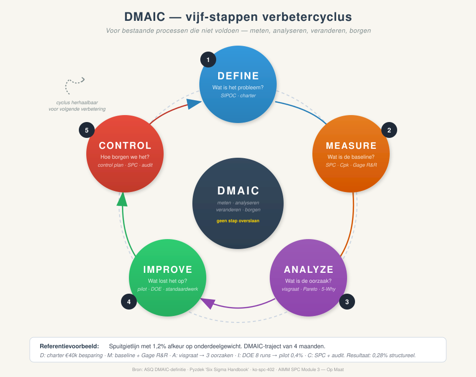

# Hoe ontwerp je een DMAIC-traject voor je eigen lijn?

Je ziet een probleem op je lijn — chronische afkeur, periodieke uitval, ongelijke kwaliteit tussen shifts. Hoe pak je dat structureel aan? Niet door direct te improviseren, maar door DMAIC: een vijf-fasen verbeterroute uit Six Sigma die zorgt dat verbetering ook beklijft.

## Wat leer je?

Je leert de **vijf DMAIC-fasen** zo toepassen dat je een verbeterproject voor je eigen lijn kunt ontwerpen — met meetbare KPI, oorzaakanalyse, gecontroleerde pilot en geborgde control.

## De vijf fasen

| Fase | Centrale vraag | Typische tools | Wat lever je op? |
|------|----------------|----------------|------------------|
| **Define** | Wat is het probleem en waarom is het belangrijk? | SIPOC, projectcharter, klachtdefinitie | Scherp afgebakend probleem + klant-impact |
| **Measure** | Wat is de huidige prestatie? | SPC-baseline, Gage R&R, defectdefinities | Baseline-Cpk + meetkwaliteit aangetoond |
| **Analyze** | Waardoor ontstaat het probleem? | Visgraat, Pareto, 5x waarom, hypothesetoetsen | 3+ oorzaakhypothesen met onderbouwing |
| **Improve** | Welke verandering lost het op? | DOE, pilots, parameterinstelling, standaardwerk | Geteste verandering met bewijslast |
| **Control** | Hoe borgen we de winst? | Control plan, SPC, visuele standaarden, escalatie | Verbetering vasthouden in dagelijkse routine |

## Waarom deze structuur?

Zonder DMAIC vervalt verbetering vaak in:
- **Snelle aannames** ("het zal wel de operator zijn")
- **Symptoombestrijding** zonder oorzaakanalyse
- **Verbeteringen die niet beklijven** ("we hadden het toch opgelost?")

DMAIC dwingt: eerst meten, dan analyseren, dan veranderen, dan borgen.

## Operator-rol vs teamleider-rol

| Fase | Wat doet de operator? | Wat doet de teamleider? |
|------|------------------------|--------------------------|
| Define | Bijdragen vanuit ervaring | SIPOC-sessie faciliteren, charter opstellen |
| Measure | Eerlijke baseline-metingen | Meetplan opzetten, Gage R&R organiseren |
| Analyze | Met team patronen herkennen | Visgraat / 5-Why sessies leiden, data-analyse |
| Improve | Pilots uitvoeren, varianten testen | DOE-experimenten coördineren, change management |
| Control | SPC-kaart bijhouden, signalen rapporteren | Control plan opstellen, SPC-systeem inrichten, audits |

## Een concreet voorbeeld

Een spuitgietlijn heeft chronisch 1,2 % afkeur door dimensionale afwijkingen. Het verbeterteam doorloopt DMAIC:

- **D**: Charter opgesteld — afkeur naar < 0,3 % in 3 maanden, met bedrijfscase van € 40.000 besparing.
- **M**: Baseline gemeten via SPC-kaart. Gage R&R laat zien dat het meetsysteem 18 % van de variatie verklaart (te hoog).
- **A**: Visgraat onthult drie hoofdoorzaken: matrijskoeling, materiaalvocht, instelling restdruk.
- **I**: DOE met 8 runs leidt tot een nieuwe parameter-set. Pilot bevestigt 0,4 % afkeur.
- **C**: Control plan met SPC-bewaking op de drie kritische parameters, operator-werkinstructies, maandelijkse audits.

Resultaat na 4 maanden: 0,28 % afkeur. Structureel geborgd via SPC-kaarten.

## Verschil met andere methoden

- **PDCA** (Plan-Do-Check-Act, Deming) — lichtere cyclus, algemener toepasbaar
- **DMADV** — voor ontwerp van **nieuwe** processen (Design For Six Sigma). DMAIC is voor **bestaande** processen.

## Wat is je eigen scope?

Voor je eerste DMAIC-project: kies een probleem dat
- meetbaar is (zonder dat is Define onmogelijk)
- niet de hele fabriek raakt (scope-creep voorkomen)
- waar data over beschikbaar is (Measure mag geen blokkade zijn)
- waar je teamleider tijd voor kan vrijmaken in een kwartaal

Een Yellow-Belt-functioneel niveau is genoeg om mee te draaien. Green-Belt-niveau (= functioneel teamleider) is genoeg om een project zelf te trekken.

## Na deze sessie

Je kunt:
- Een DMAIC-skeleton invullen voor een probleem op je eigen lijn
- Voor elke fase de centrale vraag stellen + de juiste tool kiezen
- Voorkomen dat je in symptoombestrijding belandt
- Control inbouwen vóór je het verbeterproject afsluit

In de workshop vul je een DMAIC-canvas voor een eigen lijn-casus, doet peer-review met een collega, en deelt je eerste maandag-actie plenair.

---

## Werkbladen (Kolb-cyclus)

1. [`wb-01-handout-dmaic.md`](./werkbladen/wb-01-handout-dmaic.md) — Handout dmaic
2. [`wb-02-dmaic-canvas.md`](./werkbladen/wb-02-dmaic-canvas.md) — Dmaic canvas
3. [`wb-03-peer-review.md`](./werkbladen/wb-03-peer-review.md) — Peer review
4. [`wb-04-deelronde-format.md`](./werkbladen/wb-04-deelronde-format.md) — Deelronde format

## Verder

- Onderliggend kennisobject: [`ko-spc-402`](../../kennisbank/spc/six_sigma/ko-spc-402.md)
- Voor de begeleider: [`trainer.md`](./trainer.md) + [`draaiboek.md`](./draaiboek.md)
