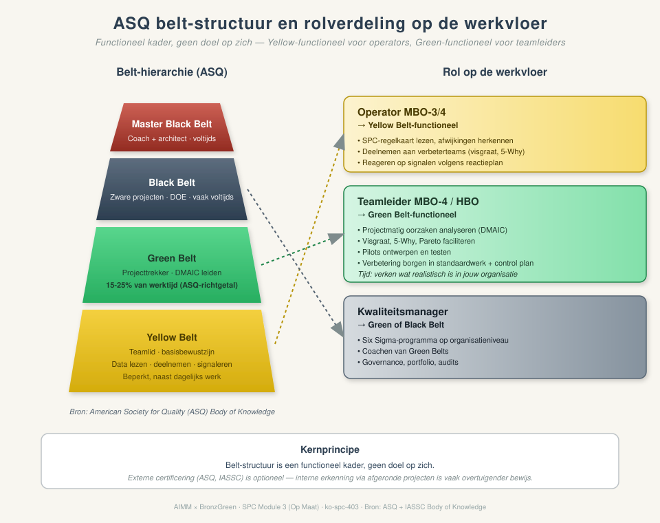

# Welk belt-niveau past bij jouw rol?

Six Sigma kent een belt-structuur: Yellow, Green, Black, Master Black. Klinkt als karate — en net als bij karate is de vraag niet "welke band haal ik", maar: "welke vaardigheden heb ik nodig voor mijn werk?"

## Wat leer je?

Je leert de **ASQ belt-structuur** zo begrijpen dat je voor jouw eigen rol kunt bepalen welke vaardigheden functioneel passen — en of een formeel certificaat voor jou zinvol is.

## De belt-niveaus volgens ASQ

Bron: American Society for Quality (ASQ) — het internationaal meest gebruikte kader.

| Belt | Rol | Wat kun je? | Tijdsbeslag |
|------|-----|-------------|-------------|
| **Yellow Belt** | Teamlid met basisbewustzijn | Data lezen, deelnemen aan verbeterteams, signaleren | Beperkt — naast dagelijks werk |
| **Green Belt** | Projecttrekker naast dagelijks werk | DMAIC leiden, statistische tools toepassen | **~15-25% van werktijd** (ASQ-richtgetal) |
| **Black Belt** | Leider van zwaardere verbeterprojecten | Geavanceerde statistiek, DOE, change management, coaching | Vaak voltijds |
| **Master Black Belt** | Coach + systeemarchitect | Black Belts opleiden, programma-strategie | Voltijds, senior |

> **Let op:** "15-25% van werktijd" is een **ASQ-richtgetal voor Green Belt**. Niet elk bedrijf houdt dit aan — sommige vragen meer, andere minder. Check wat realistisch is in jouw organisatie.

## Voor MBO: nuchter positioneren

Niet iedereen hoeft formeel "belt" te worden. Belangrijker is welke vaardigheden je functioneel nodig hebt.

### Operators → Yellow Belt-vaardigheden

- Data lezen (regelkaart, dashboard, trend)
- Deelnemen aan verbeterteams
- Reageren op signalen volgens reactieplan
- SPC-discipline in dagelijks werk
- Bijdragen aan oorzaakanalyse

### Teamleiders → groeien richting Green Belt-logica

- Projectmatig oorzaken analyseren
- Visgraat / 5-Why / Pareto faciliteren
- Verbeteringen ontwerpen en testen
- Verbeteringen borgen in standaardwerk
- SPC-systeem inrichten en onderhouden

## Formele certificering — wel of niet?

Externe certificering (ASQ, IASSC) is **optioneel**. Veel bedrijven werken met **interne erkenning** gekoppeld aan afgeronde verbeterprojecten — vaak zinvoller voor de werkvloer dan een diploma aan de muur.

**Wanneer is extern certificeren wél zinvol?**
- Je werkt bij een bedrijf dat formele belts vereist voor promotie
- Je overweegt een overstap naar een kwaliteitsfunctie
- Je wilt externe erkenning die bij meerdere werkgevers geldig is

**Wanneer is intern ontwikkelen beter?**
- Je bedrijf heeft een eigen verbetertraject met aftekenmomenten
- Je leert sneller door in echte projecten mee te draaien
- De tijd die in extern examen gaat zitten is beter besteed aan de praktijk

## Wat hoort bij jouw rol?

| AIMM-doelgroep | Belt-equivalent | Functionele focus |
|----------------|-----------------|-------------------|
| Operator MBO-3/4 | Yellow Belt-functioneel | SPC-basis, signaal-respons, deelname aan verbeterteam |
| Teamleider MBO-4/HBO | Green Belt-functioneel | DMAIC, oorzaakanalyse, verbetering, borging |
| Kwaliteitsmanager | Green of Black Belt | Programma-design, governance, strategie |

## Een fictief voorbeeld uit de praktijk

> **Fictief scenario** (illustratief, niet op een echt bedrijf gebaseerd):
>
> Een metaalverwerker richt de SPC/Six Sigma-aanpak als volgt in:
>
> - **Operators** krijgen 4 dagdelen Yellow Belt-training: SPC-basis, meetdiscipline, deelname aan verbeterteams. Geen examen — wel een aftekenmoment door de teamleider.
> - **Teamleiders** doen een intern Green Belt-traject: 8 dagen over 6 maanden, met een afsluitend eigen DMAIC-project op hun lijn (besparing > €15.000 vereist).
> - **Kwaliteitsmanager** is extern gecertificeerd Black Belt en coacht alle Green Belts.
>
> De belt-structuur is hier een **functioneel kader**, geen doel op zich.

## Wat ga je zo doen?

In deze sessie positioneer je jouw eigen rol:

1. **wb-03 (handout)** — ASQ belt-structuur op één pagina
2. **wb-01 (eigen rol)** — Welk belt-equivalent past bij jouw werk? Wat heb je al, wat mist?
3. **wb-02 (STARRT)** — Reflectie op een eerdere verbeter-ervaring: welke vaardigheid kwam tekort?

Aan het eind heb je één concreet leer- of ontwikkeldoel voor komend kwartaal.

## Onthoud dit

1. **Belt-structuur is een kader, geen doel** — functioneel werkt het, formeel is optioneel.
2. **Operators → Yellow Belt-functioneel** — data lezen, signaleren, meedoen.
3. **Teamleiders → Green Belt-functioneel** — DMAIC trekken, oorzaken vinden, borgen.
4. **Externe certificering** — alleen zinvol als je bedrijf het vereist of je buiten je huidige werkgever wilt kunnen aantonen wat je kan.
5. **Interne erkenning** via afgeronde projecten is vaak overtuigender dan een diploma.

---

*Bron: ko-spc-403 (ASQ belt-structuur); ASQ Body of Knowledge; IASSC Body of Knowledge | AIMM Module 3 — SPC Op Maat*

---

## Werkbladen (Kolb-cyclus)

1. [`wb-01-eigen-rol.md`](./werkbladen/wb-01-eigen-rol.md) — Eigen rol
2. [`wb-02-reflectie.md`](./werkbladen/wb-02-reflectie.md) — Reflectie
3. [`wb-03-handout.md`](./werkbladen/wb-03-handout.md) — Handout

## Verder

- Onderliggend kennisobject: [`ko-spc-403`](../../kennisbank/spc/six_sigma/ko-spc-403.md)
- Voor de begeleider: [`trainer.md`](./trainer.md) + [`draaiboek.md`](./draaiboek.md)
