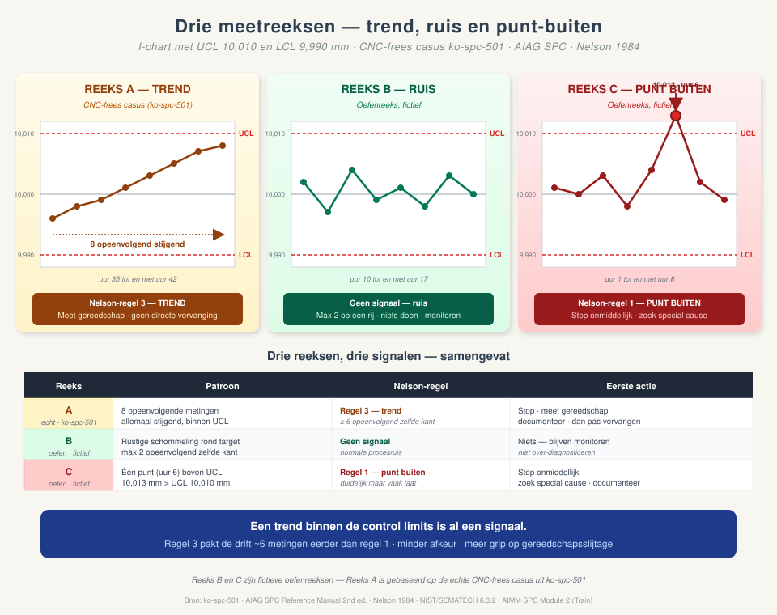

# Hoe zie je gereedschapsslijtage vóórdat de eerste uitvaller komt?

Op je CNC-lijn draai je een serie van 2000 stuks. De klant eist een boorgat-diameter van 10,00 ± 0,02 mm. Je meet elk uur 3 stuks. Alles ligt keurig tussen de control limits. En tóch zitten er na 40 uur productie 200 stukken in de uitval-bak. Hoe kan dat?

## Wat leer je?

Je leert een **I-MR-regelkaart** inrichten voor een kritische maat van je eigen lijn, en je leert **Nelson-regel 3 (trend)** herkennen — het signaal dat een stijgende of dalende reeks al een waarschuwing is, ook als er geen enkel punt buiten de grenzen valt.

## De centrale vraag

> **Wanneer is een rij metingen die bínnen de grenzen blijven tóch al een waarschuwing?**

Antwoord: **zodra 6 of meer metingen achter elkaar dezelfde kant op kruipen.** Dat is Nelson-regel 3 — de trend. Typische oorzaak op een CNC-lijn: gereedschapsslijtage.

## Waarom I-MR en geen gewone X̄-R-kaart?

Een **X̄-R-kaart** werkt met subgroepen: je meet bijvoorbeeld elk uur 5 stuks achter elkaar, en plot het gemiddelde. Dat werkt als je een "natuurlijke subgroep" hebt — meerdere stuks uit dezelfde toestand van de machine.

Op veel lijnen heb je dat **niet**: elk stuk is uniek, je meet er maar één per uur, of er zit tijd tussen de metingen. Dan gebruik je een **I-MR-kaart** (Individual + Moving Range):

| Chart | Wat plot je? | Wanneer gebruik je het? |
|-------|--------------|-------------------------|
| **X̄-R** | Gemiddelde + spreiding per subgroep | Meerdere stuks per meting, natuurlijke subgroep |
| **I-MR** | Elke individuele meting + verschil met vorige meting | Unieke metingen, geen natuurlijke subgroep |

Voor de CNC-frees casus (boorgat, 3 metingen per uur, seriële bestelling): **I-MR is geschikt** omdat elke meting als uniek wordt behandeld.

## De CNC-frees casus in het kort

> **Bron:** ko-spc-501 — CNC-frees casus uit de maakindustrie-praktijk.

- **Product:** 2000 boorgaten frezen
- **Tolerantie:** 10,00 ± 0,02 mm
- **Meetstrategie:** elk uur 3 stuks meten, plotten op I-MR-kaart
- **Signaal na 40 uur:** 6 opeenvolgende metingen geleidelijk stijgend richting bovengrens — **geen** enkel punt buiten UCL
- **Patroon:** Nelson-regel 3 (trend)
- **Oorzaak:** freesgereedschap heeft 0,015 mm slijtage opgelopen
- **Actie:** tooling vervangen → voorkomt dat de **volgende 200 stuks** out-of-spec gaan

Cijfers ter illustratie: bij een slijtage van 0,0004 mm/uur groeit de diameter over 40 uur met 0,016 mm. Start op 9,990 mm → eind op 10,006 mm. Nog net binnen specs (≤ 10,02 mm), maar de trend was al lang vóór de spec-overschrijding zichtbaar op de kaart.

## Wat is een trend volgens Nelson-regel 3?

**6 of meer opeenvolgende punten** die allemaal dezelfde kant op gaan — allemaal stijgend, of allemaal dalend. Het maakt niet uit of ze binnen de control limits blijven: de volgorde is het signaal.

> **Waarom 6?** Statistisch is de kans dat 6 punten toevallig dezelfde kant op gaan ongeveer 1 op 64. Dan is het geen toeval meer, maar een systematische verschuiving.

## Typische trend-veroorzakers in de praktijk

| Veroorzaker | Hoe merk je het? |
|-------------|------------------|
| **Gereedschapsslijtage** | Diameters kruipen langzaam naar boven (slijtage = minder materiaal weggenomen) |
| **Temperatuur-drift** | Maten veranderen met het opwarmen van machine of ruimte |
| **Materiaaluitputting** | Bad-concentratie, smeermiddel, koelvloeistof raakt op |
| **Zetting van afstelling** | Kleine verschuiving die langzaam groeit |

## Wat doe je als je een trend ziet?

**Niet:** direct het gereedschap vervangen.
**Wel:** stoppen, meten, checken, documenteren.

De vijf operator-stappen uit de casus:

1. **Stop** de machine (of signaleer en laat een bevoegde collega stoppen)
2. **Meet** het gereedschap — in de casus: 0,015 mm slijtage bevestigd
3. **Vervang** de tooling (of laat vervangen)
4. **Documenteer:** signaal + oorzaak + actie + effect
5. **Hervat** productie met monitoring

Documentatie is geen bureaucratie — het is het enige wat ervoor zorgt dat je collega's en je vervangers morgen dezelfde trend eerder herkennen.

## Na deze sessie

Je kunt:

- Uitleggen waarom I-MR gekozen wordt bij unieke metingen
- Nelson-regel 3 (trend) herkennen in een meetreeks
- Het verschil benoemen tussen regel 1 (punt-buiten-UCL) en regel 3 (vroege waarschuwing)
- Voor je eigen lijn bepalen: welke maat vraagt om I-MR-bewaking?

In de workshop krijg je eerst de oefening (wb-01), dan de STARRT-reflectie (wb-02), dan de handout met actieplan (wb-03).

---
*Bron: ko-spc-501 — CNC-frees casus; AIAG SPC Reference Manual; operator-cases maakindustrie | AIMM Module 2 — SPC Train | v1.0*

---

## Werkbladen (Kolb-cyclus)

1. [`wb-01-oefening.md`](./werkbladen/wb-01-oefening.md) — Oefening
2. [`wb-02-reflectie.md`](./werkbladen/wb-02-reflectie.md) — Reflectie
3. [`wb-03-handout.md`](./werkbladen/wb-03-handout.md) — Handout

## Verder

- Onderliggend kennisobject: [`ko-spc-501`](../../kennisbank/spc/regelkaarten/ko-spc-501.md)
- Voor de begeleider: [`trainer.md`](./trainer.md) + [`draaiboek.md`](./draaiboek.md)
