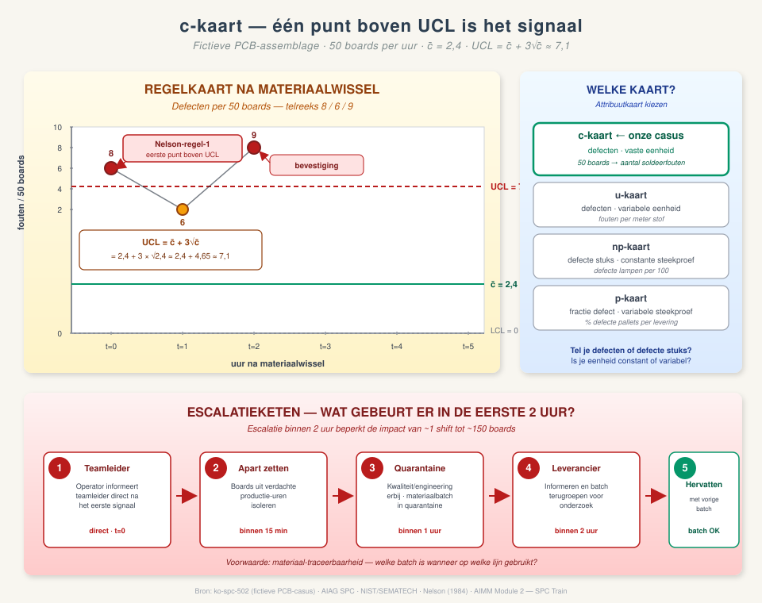

# Wanneer is een paar fouten meer écht een signaal?

Een nieuwe materiaalbatch komt binnen. In het eerste uur na de wissel zie je bij de visuele inspectie 8 soldeerfouten op 50 boards. Normaal zijn het er ongeveer 2 of 3. Is dit toeval, of is er iets mis? Wacht je nog een uurtje af, of trek je nu aan de bel?

Dit soort momenten bepalen of een materiaalbatch één shift raakt — of drie.

## Wat leer je?

Je leert **welke regelkaart** past bij jouw telgegevens (en waarom het een c-kaart is, geen p of np), hoe je **zelf de bovengrens berekent** met een eenvoudige formule, en **welk signaal** betekent dat je nu moet escaleren en niet later.

## De centrale zin

> Tel je **defecten per gelijke eenheid** (50 boards, 100 stuks, 1 pallet)?
> Dan is de **c-kaart** je kaart. Eén punt boven UCL = **Nelson-regel-1**: escaleren.

## De casus waarmee je werkt (fictief voorbeeld, PCB-assemblage)

Assemblagelijn voor printplaten (PCB). Elk uur inspecteer je **50 geassembleerde boards** visueel op soldeerfouten. Over de laatste weken is het gemiddelde **c̄ = 2,4 fouten per 50 boards**.

**UCL berekenen:** UCL = c̄ + 3√c̄ = 2,4 + 3 × √2,4 = 2,4 + 3 × 1,549 ≈ **7,1 fouten**
**LCL:** c̄ − 3√c̄ = 2,4 − 4,65 = negatief → **LCL = 0** (afkappen).

Na een **materiaalwissel** (nieuwe leverancier-batch) zie je deze reeks:

| Uur | Aantal fouten | Beoordeling |
|-----|---------------|-------------|
| t=0 | 8 | **Boven UCL (7,1) — Nelson-regel-1!** |
| t=1 | 6 | Hoog, maar binnen UCL |
| t=2 | 9 | **Weer boven UCL — bevestiging** |

Het patroon wijst op een **special cause** verbonden aan de nieuwe materiaalbatch.

## Welke kaart — c, p of np?

| Jij telt... | ...per... | Kaart |
|-------------|-----------|-------|
| **Defecten** (een board kan er meerdere hebben) | **gelijke eenheid** (bijv. 50 boards) | **c-kaart** |
| **Defecten** | **variabele eenheid** (soms 30, soms 80 boards) | u-kaart |
| **Defecte stuks** (een stuk telt 1× mee) | gelijke steekproef | np-kaart |
| **Fractie defect** (%) | variabele steekproef | p-kaart |

In onze casus: je telt **fouten** (een board kan meerdere soldeerfouten hebben) per **vaste eenheid** (50 boards). Dat is **c**.

## De escalatieketen — in de goede volgorde

1. **Operator** informeert **teamleider** direct na het eerste signaal (t=0)
2. Boards uit verdachte productie-uren **apart zetten**
3. Escalatie naar **kwaliteit en engineering**
4. Materiaalbatch in **quarantaine**
5. **Leverancier** informeren — **terugroepen** voor onderzoek
6. Productie hervatten met monsters van **vorige** batch

## Wat levert het op?

Escalatie binnen 2 uur na het eerste signaal beperkt de impact tot **~150 boards** (3 uur × 50). Zonder snelle escalatie raakt het al snel **meer dan één shift** — dat zijn duizenden boards.

## Voorwaarde: traceerbaarheid

De hele keten werkt alleen als **materiaal-traceerbaarheid** geregeld is: welke batch is wanneer binnengekomen, op welke lijn gegaan, in welke boards verwerkt. Zonder die koppeling is Nelson-regel-1 nog steeds zichtbaar — maar terugroepen lukt niet.

## Na deze sessie

Je kunt:
- Bij telgegevens de juiste kaart kiezen (c, niet p of np) en in één zin uitleggen waarom
- Zelf de UCL berekenen met c̄ + 3√c̄ en begrijpen waarom LCL soms 0 wordt
- Een punt boven UCL herkennen als Nelson-regel-1 signaal
- De eerste twee stappen van de escalatieketen benoemen

In de workshop werk je met de PCB-casus. Je kiest de kaart, rekent de UCL uit, markeert het signaal — en we bespreken wat jij op jouw lijn telt dat hier op lijkt.

---
*Bron: ko-spc-502 (c-kaart casus); AIAG SPC Reference Manual; fictieve casus geïllustreerd uit operator-praktijk | AIMM Module 2 — SPC Train | v1.0*

---

## Werkbladen (Kolb-cyclus)

1. [`wb-01-oefening.md`](./werkbladen/wb-01-oefening.md) — Oefening
2. [`wb-02-reflectie.md`](./werkbladen/wb-02-reflectie.md) — Reflectie
3. [`wb-03-handout.md`](./werkbladen/wb-03-handout.md) — Handout

## Verder

- Onderliggend kennisobject: [`ko-spc-502`](../../kennisbank/spc/regelkaarten/ko-spc-502.md)
- Voor de begeleider: [`trainer.md`](./trainer.md) + [`draaiboek.md`](./draaiboek.md)
