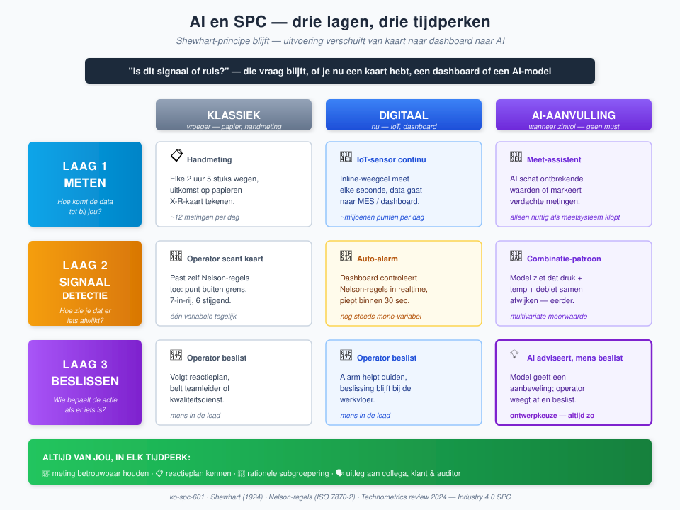

# AI en SPC — hoe werken ze samen op jouw machine?

Je werkt op een lijn waar steeds meer sensoren zitten. Misschien heb je een dashboard in plaats van een papieren kaart. Misschien piept er automatisch een alarm als iets uit de rails loopt. Misschien komt er binnenkort een AI-aanbeveling bij. Hoe past dat allemaal samen — en waar ligt jouw rol?

## Wat leer je?

Je leert op je **eigen machine** te zien waar klassieke SPC blijft gelden, waar digitale SPC het overneemt, en waar AI echt iets toevoegt bovenop wat je al hebt.

## De centrale zin

> **"AI en SPC zijn geen concurrenten. Shewhart bedacht in 1924 het onderscheid tussen signaal en ruis — en dat onderscheid is vandaag belangrijker dan ooit, juist omdat sensoren miljoenen punten per dag leveren."**

## Drie lagen — wat verandert, wat blijft?

| Laag | Klassiek (vroeger) | Digitaal (nu) | AI-aanvulling (wanneer zinvol) |
|------|--------------------|----------------|--------------------------------|
| **1. Meten** | Handmatig elke 2 uur 5 stuks | Continu via IoT-sensor | AI kan ontbrekende data schatten of meetfouten herkennen |
| **2. Signaal-detectie** | Operator scant kaart, past Nelson-regels toe | Dashboard met automatisch alarm op Nelson-regels | AI herkent complexe patronen die Nelson-regels niet zien (bv. combinatie van 3 variabelen) |
| **3. Beslissen** | Operator bepaalt actie | Operator bepaalt actie (alarm helpt) | AI kan een aanbeveling geven; operator beslist |

**Wat blijft:** het Shewhart-principe — onderscheid tussen normale variatie en een echt signaal. Een sensor die elke seconde meet, verandert niets aan de vraag: *is dit signaal of ruis?*

## Nelson-regels + AI — wie doet wat?

**Nelson-regels** (zoals je kent uit ko-spc-103) zijn en blijven correct:
- Punt buiten de controlegrenzen → onderzoek
- 7 punten op één rij aan dezelfde kant → trend
- Stijgend of dalend patroon van 6 → drift

Ze zijn helder, uitlegbaar en werken op één variabele. Maar:

- Ze zien **één variabele tegelijk**. Een echt probleem ontstaat soms pas als druk, temperatuur en debiet **samen** afwijken.
- Ze zien **geen complexe patronen** zoals een langzaam kantelende verhouding tussen twee metingen.

Daar voegt AI waarde toe — **als aanvulling, niet als vervanging**.

## Fictieve referentiecasus — chemische reactor

> *Let op: dit is een fictief voorbeeld om het samenspel te illustreren.*

In een **chemische reactor** worden druk, temperatuur en debiet continu gemeten. Met klassieke SPC heeft elke variabele zijn eigen controlekaart. De Nelson-regels detecteren:
- Te hoge druk → alarm
- Temperatuurdrift → alarm
- Debiet buiten tolerantie → alarm

**Wat AI toevoegt:** een model dat is getraind op historische batch-data, herkent dat de *combinatie* van 'temperatuur iets aan de hoge kant + debiet iets aan de lage kant + druk normaal' vaak voorafgaat aan een off-spec batch — ook al staat elke variabele nog binnen zijn eigen grenzen. Het model geeft een **vroege waarschuwing** die klassieke SPC 40 minuten later pas zou zien.

**Wat AI niet doet:** de reactor stilzetten. De operator beslist. De Nelson-regels blijven actief als tweede net.

## Jouw rol verschuift — niet weg

Vroeger: kaart tekenen, punten plotten, regel-triggers herkennen, actie uitvoeren.

Nu en straks: *procesgedrag begrijpen* ongeacht wie het eerste signaleert — jij, het dashboard of een AI-model. Je taak verschuift van **signaaldetectie** naar **duiden en beslissen**:

- Wat betekent dit alarm in de context van deze shift, deze batch, deze grondstof?
- Klopt de AI-aanbeveling met wat ik zie op de werkvloer?
- Wanneer is een auto-alarm niet genoeg en moet ik zelf ingrijpen?

## Waar AI **geen** meerwaarde heeft

Eerlijk verhaal. AI voegt niks toe als:
- Je meetsysteem onbetrouwbaar is (garbage in = garbage out)
- Er weinig historische data is om een model op te trainen
- Het probleem eenvoudig is en Nelson-regels het prima zien
- Niemand de AI-uitkomst kan uitleggen aan een klant of auditor

In die gevallen: **blijf bij klassiek + digitaal**. Niet iedere lijn heeft AI nodig.

## Wat blijft altijd jouw verantwoordelijkheid?

- De **meting** betrouwbaar houden (kalibratie, onderhoud)
- Het **reactieplan** kennen en uitvoeren
- Het **rationele subgroeperen** (welke ploeg, batch, grondstof)
- De **uitleg** aan collega, klant en auditor

Een AI-model kan je signaal geven. Het kan niet voor jou beslissen of het proces vandaag veilig door mag.

## Na deze sessie

Je kunt:
- Voor je eigen machine benoemen wat klassiek blijft, wat digitaal is en waar AI zou passen
- Uitleggen waarom het Shewhart-principe ook in het AI-tijdperk blijft gelden
- Nuchter inschatten of AI op jouw lijn zinvol is — of juist niet
- Eén concrete kans of zorg bespreken met je leidinggevende

In de werkvorm vul je een synthese-werkblad voor je eigen machine in, doe je een STARRT-reflectie en neem je één vraag mee naar je team-overleg.

---

*Bron: ko-spc-601 (Digitale SPC en sensordata); Technometrics-review 2024 over Industry 4.0 SPC; ISO 7870-2 | AIMM Module 3 — SPC Op Maat | v1.0*

---

## Werkbladen (Kolb-cyclus)

1. [`wb-01-synthese-opdracht.md`](./werkbladen/wb-01-synthese-opdracht.md) — Synthese opdracht
2. [`wb-02-reflectie.md`](./werkbladen/wb-02-reflectie.md) — Reflectie
3. [`wb-03-handout.md`](./werkbladen/wb-03-handout.md) — Handout

## Verder

- Onderliggend kennisobject: [`ko-spc-601`](../../kennisbank/spc/ai_integratie/ko-spc-601.md)
- Voor de begeleider: [`trainer.md`](./trainer.md) + [`draaiboek.md`](./draaiboek.md)
