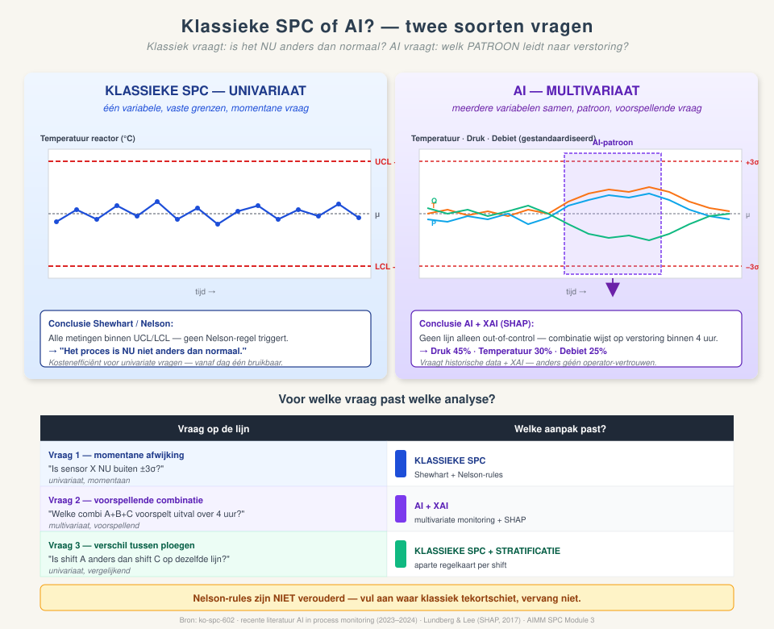

# Wanneer schiet klassieke SPC tekort en wanneer past AI?

Klassieke SPC werkt al een eeuw. Maar moderne lijnen hebben tientallen sensoren, complexe interacties en autocorrelatie. Op welke vragen geeft een Nelson-regel nog antwoord, en wanneer heb je AI nodig?

## Wat leer je?

Je leert wanneer je een **klassieke SPC-aanpak** kiest en wanneer een **AI-uitbreiding** echt iets toevoegt. En je leert waarom **explainable AI** (XAI) geen luxe is maar een voorwaarde voor operator-vertrouwen.

## Wanneer schiet klassieke SPC tekort?

Traditionele control charts gaan uit van aannames die in moderne productieomgevingen zwakker worden:

| Aanname klassieke SPC | Werkelijkheid moderne lijnen |
|------------------------|------------------------------|
| Lage dimensie (1 variabele) | Tientallen sensoren tegelijk |
| Lineaire verbanden | Niet-lineaire interacties |
| Onafhankelijke metingen | Autocorrelatie tussen tijdspunten |
| Stabiele baseline | Dynamische, adaptieve processen |

## Het nuttige onderscheid

| Vraag | Wie beantwoordt 'm? |
|-------|----------------------|
| "Is het proces NU anders dan normaal?" | **Klassieke SPC** (Shewhart, Nelson) |
| "Welk PATROON leidt naar een verstoring?" | **AI** (predictive monitoring) |
| "Welke SIGNALEN dragen het meest bij?" | **Explainable AI** (SHAP, LIME) |

## Nelson is NIET verouderd

Het betekent niet dat Nelson-rules verouderd zijn. Het betekent wel dat ze in moderne lijnen soms **te weinig zien** van multivariate en niet-lineaire patronen.

Voorbeeld: tien sensoren die ieder binnen ±3σ blijven kunnen collectief een fout-conditie aangeven. Geen Nelson-regel ziet dat. Een multivariate AI wel.

## Explainable AI (XAI) — voorwaarde, geen optie

Black-box-systemen zonder uitlegbaarheid **ondermijnen vertrouwen**, vooral in omgevingen met hoge proces- of veiligheidsimpact.

Daarom veel aandacht voor:
- **SHAP** (Shapley Additive Explanations) — laat zien welke variabelen het meest bijdragen aan een alarm
- **LIME** (Local Interpretable Model-agnostic Explanations) — geeft per geval een uitleg
- **Hybride interpretabele modellen**

Operators moeten begrijpen **waarom** een AI-alarm afgaat, niet alleen dát het afgaat.

## Een concreet voorbeeld

Bij een chemische reactor monitort een traditioneel SPC-systeem temperatuur: alle waarden binnen ±3σ, geen Nelson-regels triggeren. Maar de AI-laag detecteert dat de combinatie van **temperatuur** (+1σ) + **druk** (+0,5σ) + **debiet** (−0,8σ) een patroon vormt dat historisch in 78 % van de gevallen vooraf ging aan een katalysator-degradatie binnen 4 uur.

De operator krijgt een alarm met SHAP-verklaring: *"Druk is hoofdcontributor (45 %), temperatuur tweede (30 %), debiet derde (25 %)."* De operator begrijpt waarom, kan gericht actie ondernemen (drukvalcheck), voorkomt 6 uur productiestop.

## De rol van de operator verandert

| Klassiek | Modern |
|----------|--------|
| Detector — zelf signalen scannen | Interpreteerder — alarm beoordelen |
| Regelvolger — Nelson-rules toepassen | Systeem-bewaker — alarmen rationaliseren |

Data Literacy is voorwaarde — zonder dat geen zinvolle interpretatie.

## Wanneer NIET AI inzetten?

- Als er minder dan 6 maanden historische data is (te weinig om patronen te leren)
- Als er geen XAI-laag is (black-box → operator-vertrouwen weg)
- Als klassieke SPC al voldoet (waarom complexer maken?)
- Als de meetkwaliteit niet op orde is (Gage R&R eerst)

## Na deze sessie

Je kunt:
- Voor een vraag op je eigen lijn beoordelen of klassieke SPC of AI past
- Uitleggen waarom Nelson-rules niet verouderd zijn
- De rol van XAI benoemen als voorwaarde voor operator-vertrouwen
- Voorkomen dat je AI inzet zonder voldoende data of zonder uitlegbaarheid

In de workshop vul je een eigen-lijn-screen in met 5 criteria en kies je voor een concrete vraag de juiste aanpak.

---

## Werkbladen (Kolb-cyclus)

1. [`wb-01-klassiek-vs-ai-tabel.md`](./werkbladen/wb-01-klassiek-vs-ai-tabel.md) — Klassiek vs ai tabel
2. [`wb-01-klassiek-vs-ai.md`](./werkbladen/wb-01-klassiek-vs-ai.md) — Klassiek vs ai
3. [`wb-02-eigen-lijn-screen.md`](./werkbladen/wb-02-eigen-lijn-screen.md) — Eigen lijn screen
4. [`wb-03-reflectie.md`](./werkbladen/wb-03-reflectie.md) — Reflectie
5. [`wb-03-xai-handout.md`](./werkbladen/wb-03-xai-handout.md) — Xai handout

## Verder

- Onderliggend kennisobject: [`ko-spc-602`](../../kennisbank/spc/ai_integratie/ko-spc-602.md)
- Voor de begeleider: [`trainer.md`](./trainer.md) + [`draaiboek.md`](./draaiboek.md)
