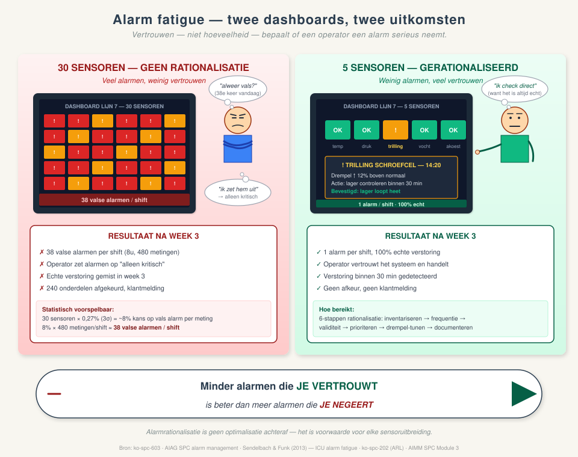

# Hoe voorkom je dat operators alarmen gaan negeren?

Een lijn met 30 nieuwe sensoren levert 30-40 valse alarmen per shift. Na een week zet de operator alarmen op "alleen kritisch". Een week later wordt een echte verstoring gemist. Dit heet het cry-wolf-effect — en het is een van de grootste valkuilen van digitale SPC.

## Wat leer je?

Je leert wat **alarm fatigue** is, waarom het kritisch is in industriële omgevingen, en hoe je een **alarmrationalisatie-proces** opzet voor je eigen lijn.

## Het probleem

Digitale SPC + AI levert **veel meer alarmen** op dan klassieke SPC. Bij elk alarm dat **vals** blijkt, neemt het operator-vertrouwen af.

Eindresultaat:
- Operator negeert alarmen ("toch weer vals")
- Operator schakelt alarmen uit
- Echte verstoringen worden gemist
- Het systeem wordt **onbetrouwbaar door overbetrouwbaarheid**

Dit heet **alarm fatigue** of het **cry-wolf-effect** — naar het verhaal van de jongen die "wolf" riep.

## Waarom industrieel kritisch?

In medische monitoring is alarm fatigue een bekend probleem (zie literatuur over patiënt-monitoring). In industriële omgevingen is het minstens zo kritisch:
- Een gemiste verstoring kan **grote afkeur** veroorzaken
- In procesindustrie: **veiligheidsrisico**
- In automotive: **klantklachten / recalls**

## De tegenintuïtieve les

> Digitale SPC zonder alarmrationalisatie kan **slechter** uitpakken dan een **simpele kaart** met een goed reactieplan.

Een lijn met één papieren X̄-R-kaart en een betrouwbaar reactieplan kan effectiever zijn dan een dashboard met 30 sensoren en honderd false positives per dag.

## Alarmrationalisatie — het 6-stappen proces

| Stap | Wat |
|------|-----|
| 1. Inventariseren | Welke alarmen bestaan er? |
| 2. Frequentie-analyse | Hoe vaak gaat elk alarm af? |
| 3. Validiteit | Welk percentage is een echte verstoring? |
| 4. Prioriteren | Welke alarmen mogen niet worden gemist? |
| 5. Drempel-tunen | Met behoud van detectie, false positives reduceren |
| 6. Documenteren | Per alarm: wat, waarom, welke actie? |

Het doel is niet "minder alarmen" maar "alleen zinvolle alarmen".

## Een concreet voorbeeld

Een productielijn voert 30 nieuwe sensoren in. Elke sensor heeft ±3σ-grenzen. Statistisch: bij 30 onafhankelijke sensoren krijgt het systeem ~30 × 0,27 % = ~8 % kans op één vals alarm per meting.

Met meting elke minuut, 8 uur shift = 480 metingen → ~38 valse alarmen per shift.

Operator stelt na week 2 het systeem op "alleen kritische alarmen". Mist daarmee een echte verstoring in week 3 → 240 onderdelen afgekeurd.

**Les**: investeer eerst in alarmrationalisatie voordat je sensoren uitbreidt.

## Wat je NIET doet

- "Wij hebben dit niet" zeggen (terwijl het er wel is — laat de operator tellen)
- Alle alarmen behouden "voor de zekerheid"
- Alleen drempels verhogen zonder rationalisatie-proces
- Operators de schuld geven ("ze moeten beter opletten")

## Verband met klassieke ARL-discussie

Dit is dezelfde afweging als bij Nelson-rules en ARL (gevoeligheid vs vals alarm). Met AI op grote schaal wordt de afweging alleen veel scherper: één extra signaalregel × duizenden datapunten = veel vals alarm.

## Voor jouw lijn

Vragen voor een mini-alarmaudit:
- Hoeveel actieve alarmen heb je momenteel?
- Welk percentage gaat per dag/week af?
- Welk percentage is achteraf "echte verstoring"?
- Welke 3 alarmen hebben de hoogste prioriteit (mogen NOOIT gemist worden)?
- Welke 3 zou je morgen kunnen uitschakelen of de drempel verhogen?

## Na deze sessie

Je kunt:
- Het cry-wolf-effect herkennen op je eigen lijn
- Het 6-stappen rationalisatie-proces toepassen
- Voorkomen dat je sensoren toevoegt zonder rationalisatie
- Een eerste alarmaudit uitvoeren binnen een maand

In de workshop lees je een cry-wolf-casus, doe je een mini-alarmaudit voor je eigen lijn, en plan je de top-3 alarmen die je deze maand gaat rationaliseren.

---

## Werkbladen (Kolb-cyclus)

1. [`wb-01-cry-wolf-casus.md`](./werkbladen/wb-01-cry-wolf-casus.md) — Cry wolf casus
2. [`wb-02-alarmaudit.md`](./werkbladen/wb-02-alarmaudit.md) — Alarmaudit
3. [`wb-02-reflectie.md`](./werkbladen/wb-02-reflectie.md) — Reflectie
4. [`wb-03-handout-rationalisatie.md`](./werkbladen/wb-03-handout-rationalisatie.md) — Handout rationalisatie
5. [`wb-03-rationalisatie-handout.md`](./werkbladen/wb-03-rationalisatie-handout.md) — Rationalisatie handout
6. [`wb-04-alarmaudit.md`](./werkbladen/wb-04-alarmaudit.md) — Alarmaudit

## Verder

- Onderliggend kennisobject: [`ko-spc-603`](../../kennisbank/spc/ai_integratie/ko-spc-603.md)
- Voor de begeleider: [`trainer.md`](./trainer.md) + [`draaiboek.md`](./draaiboek.md)
