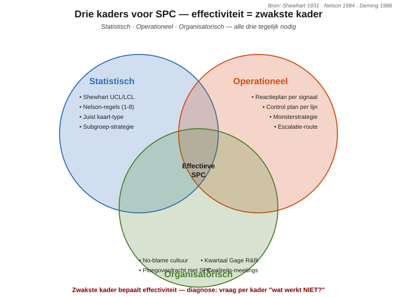

# SPC werkt alleen als drie kaders tegelijk staan

Je hebt twee modules achter de rug. Je weet hoe een regelkaart werkt (Shewhart, 1931). Je herkent Nelson-signalen 1 en 2 (Nelson, 1984). Je snapt het verschil tussen een common cause en een special cause. En toch zie je op de werkvloer dat SPC-uitrollen doodbloeden: de kaart hangt er, en niemand reageert meer op een signaal in de nachtploeg.

Dat komt bijna nooit door een gebrek aan statistiek. Het komt doordat SPC **binnen drie kaders tegelijk moet werken** — en als er één wegvalt, valt het geheel binnen een half jaar om. Deming ("Out of the Crisis", 1986) benoemt dat expliciet: SPC zonder managementverantwoordelijkheid is techniek zonder werking.

## Wat leer je?

Je leert voor jouw eigen lijn een **implementatieplan** opstellen waarin alle drie de kaders expliciet zijn ingevuld, en je leert **benoemen welk kader nu het zwakste is** — want daar zit jouw volgende actie.

## De drie kaders in één blik

| Kader | Waar gaat het over? | Wat faalt er als dit kader zwak is? |
|-------|----------------------|--------------------------------------|
| 🔵 **Statistisch** | Begrippen, kaartkeuze, signalen, Cpk | Verkeerde kaart, pseudo-SPC, "binnen tolerantie ≠ onder controle" wordt verward |
| 🟠 **Operationeel** | Sampling, reactieplan, shift-overdracht, escalatie | Kaart hangt er, niemand weet wat te doen bij signaal |
| 🟣 **Organisatorisch** | Training, MSA, managementsteun, signaalcultuur | Werkt initieel, valt na half jaar in — "we hadden SPC toch?" |

> **De kernzin.** Statistisch zonder operationeel = mooie theorie. Operationeel zonder statistisch = schijnzekerheid. Beide zonder organisatorisch = half jaar houdbaar. Dit is Shewhart + Nelson + Deming in één adem.

## 1. Statistisch kader — begrippen die scherp moeten blijven

Deze begrippen mogen op jouw lijn **niet** vereenvoudigd worden tot "binnen of buiten tolerantie":

| Begrip | Waarom kritisch op jouw lijn? |
|--------|--------------------------------|
| **Common vs special cause** (Shewhart) | Bepaalt of je ingrijpt. Ingrijpen op common cause maakt het alleen maar erger ("tampering"). |
| **Control limits vs spec limits** | Specgrenzen komen van de klant. Controlegrenzen komen uit je proces. Verwarren = einde SPC. |
| **Chart-keuze** | I-MR, X-bar/R, p-kaart, c-kaart — verkeerde keuze betekent verkeerde signalen. |
| **Nelson-signalen 1-8** (Nelson, 1984) | Signaal = patroon, niet alleen "punt buiten". Regel 2 (9 punten één kant) mist je anders. |
| **Cp / Cpk / Pp / Ppk** | Cp is potentieel, Cpk is werkelijke prestatie. Pp/Ppk is langetermijn. Uit elkaar houden. |

**Branche-context.** In MKB-maakindustrie (spuitgieten, metaalbewerking, assemblage) zie je bij een gezonde SPC-implementatie Cpk-waarden bewegen van ~1,00–1,20 (net goed genoeg) richting ~1,33–1,50 (comfortabele marge). Automotive-klanten eisen vaak Cpk ≥ 1,33 op kritische kenmerken; farma/medisch hoger. Dit zijn branche-richtwaarden, geen universele normen — check altijd je eigen klant-specificatie.

## 2. Operationeel kader — de vertaling naar dagelijks werk

SPC werkt alleen als het **operationeel vastligt wie wat doet**:

| Element | Concreet op jouw lijn |
|---------|------------------------|
| **Sampling** | Wie meet, wanneer, hoe vaak? Staat het in standaardwerk? |
| **Subgroepering** | Rationele subgroepen (Shewhart: één operator, één batch, één uur). Geen mix van bronnen. |
| **Reactieplannen** | Bij Nelson-1: containment + oorzaakcheck. Bij Nelson-2: trend-check. Staat dat op papier? |
| **Containment** | Verdachte output veiligstellen — fysiek afschermen, niet alleen "even apart". |
| **Shift-overdracht** | Signalen van ploeg 1 komen aan bij ploeg 2. Staat in de ploegboek-template. |
| **Escalatie** | Wanneer naar teamleider, wanneer naar kwaliteit, wanneer naar engineering? |

> **Herkenning.** Ontbreekt hier één element — typisch shift-overdracht of reactieplan — dan zie je signalen in de nachtploeg verdwijnen. De kaart hangt er, de meting klopt, maar het signaal komt niet bij de juiste persoon.

## 3. Organisatorisch kader — de borging

Zonder deze voorwaarden valt SPC na half jaar in, hoe goed de statistiek en operatie ook zijn:

| Voorwaarde | Wat betekent dat concreet? |
|-------------|------------------------------|
| **Training** | Iedereen die meet of beslist begrijpt SPC-basis. Niet één training bij de start — onderhoud. |
| **Meetsysteembeheersing (MSA)** | Gage R&R periodiek. Anders weet je niet of je variatie van proces of van meter meet. |
| **Control plans** | Per kritisch kenmerk vastgelegd. Niet één plan voor de hele lijn. |
| **Managementsteun** | Tijd, middelen, prioriteit. Deming: zonder management geen systeem. |
| **Signaalcultuur** | Signalen worden onderzocht, niet weggepoetst. No-blame-principe. |

**Deming (1986):** "It is management's job to work on the system." SPC zonder managementsteun is techniek die losloopt van de organisatie — en dat houdt geen half jaar vol.

## Waarom alle drie tegelijk?

| Wat je overslaat | Wat je krijgt |
|-------------------|----------------|
| Geen statistisch kader | Operationele routine zonder onderscheidingsvermogen — "pseudo-SPC" |
| Geen operationeel kader | Mooie theorie, geen werking op de werkvloer |
| Geen organisatorisch kader | Werkt initieel, verwatert binnen half jaar |

Geen van de drie kan ontbreken. Dat is de centrale les van dit leerobject.

## Fictieve illustratie — kunststofverwerker, 12 spuitgietlijnen

*Fictieve illustratie met plausibele cijfers voor een MKB-kunststofbedrijf. Geen specifieke casus; bedoeld als ijkpunt voor schaal en tempo, niet als sjabloon.*

Een kunststofverwerker rolt SPC uit op 12 spuitgietlijnen. Per kader:

- **Statistisch** — 4 dagdelen training voor operators (basis + Nelson 1+2), 8 dagdelen voor teamleiders (volledige Nelson + Cpk + DMAIC-basis).
- **Operationeel** — control plan per machine, reactieplan per signaaltype, monsterstrategie per productlijn, signaalregel in ploegoverdracht-template.
- **Organisatorisch** — kwartaalse Gage-R&R, maandelijkse kwaliteitsbespreking met operators, signalen expliciet op de ploegoverdracht-agenda, "no blame"-afspraak bij signaalmelding.

**Plausibel resultaat na 6 maanden:** ~23% afkeurreductie, gemiddelde Cpk van circa 1,15 naar 1,42, operatorvertrouwen in SPC-systeem hoog (intern gemeten). Branche-context: beweging van 1,15 naar 1,42 is voor MKB-spuitgieten realistisch binnen een half jaar mits alle drie kaders worden aangepakt.

**Cruciaal:** deze cijfers zouden het gevolg zijn van **alle drie de kaders tegelijk**. Eén kader overslaan en het patroon breekt.

## Verbinding met andere AIMM use-cases

SPC staat niet op zichzelf:

- **Predictive Maintenance** — deelt data- en anomalielogica; SPC voegt baselines en reactieplannen toe.
- **AI Kwaliteitscontrole (vision)** — levert defectdata die bruikbaar is in p-/np-/c-/u-kaarten.
- **Data Literacy** — voorwaarde om dashboards, trends, false alarms en Cpk-cijfers betekenisvol te lezen.

## In de workshop (60 min)

- **Blok 1 (10 min)** — Handout drie kaders plenair doorlopen (wb-03).
- **Blok 2 (25 min)** — Eigen implementatieplan invullen voor één concrete lijn (wb-01): per kader drie afspraken + zwakste-kader-diagnose + maandag-actie.
- **Blok 3 (15 min)** — STARRT-reflectie op een eerdere SPC-uitrol (wb-02): welk kader faalde toen, wat herken je nu?
- **Blok 4 (10 min)** — Plenaire deel-ronde: drie zinnen per deelnemer — mijn lijn, mijn zwakste kader, mijn maandag-actie.

## Na deze sessie kun je

- Voor jouw lijn benoemen welke afspraken per kader staan — en welke ontbreken.
- Het **zwakste kader** op jouw lijn diagnosticeren, met signaal waaruit dat blijkt.
- Één concrete maandag-actie formuleren die dat zwakste kader versterkt.
- Herkennen waarom eerdere SPC-uitrollen op jouw werkvloer zijn doodgebloed — en dat patroon voor jouw volgende plan doorbreken.

---

*Bronnen en referenties: Shewhart (1931) "Economic Control of Quality of Manufactured Product" — controlekaart en common/special cause; Nelson (1984) "The Shewhart Control Chart — Tests for Special Causes" — Nelson-signaalregels; Deming (1986) "Out of the Crisis" — managementverantwoordelijkheid voor SPC-werking; AIAG SPC Reference Manual; ISO 7870-1 implementatiekader; Ford PPAP organisatie-eisen; Wheeler implementatie-essays. AIMM ko-spc-701 | Module 3 — SPC Op Maat | v1.0*

---

## Werkbladen (Kolb-cyclus)

1. [`wb-01-eigen-implementatieplan.md`](./werkbladen/wb-01-eigen-implementatieplan.md) — Eigen implementatieplan
2. [`wb-02-reflectie.md`](./werkbladen/wb-02-reflectie.md) — Reflectie
3. [`wb-03-handout.md`](./werkbladen/wb-03-handout.md) — Handout

## Verder

- Onderliggend kennisobject: [`ko-spc-701`](../../kennisbank/spc/implementatie/ko-spc-701.md)
- Voor de begeleider: [`trainer.md`](./trainer.md) + [`draaiboek.md`](./draaiboek.md)
